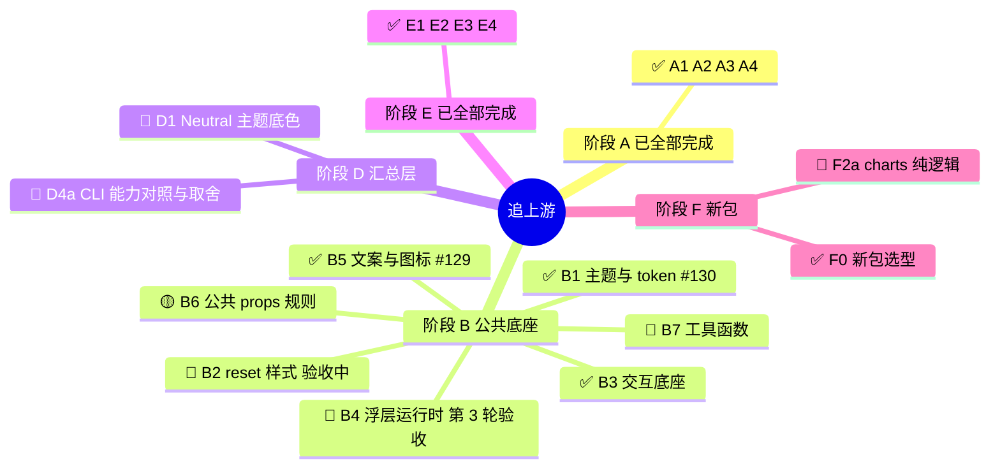

# 交接：astryx-vue 追上游 v0.7.1（蜂群总控）

## 一句话

仓库 `/Users/shenqingchuan/workspace/astryx-vue` 正在把 Vue 3 移植版追到上游 facebook/astryx v0.7.1。所有工作按一棵 63 个节点的任务树推进。你接手的是**总控**这个角色：写计划、派实现者和验收者、复核、合入、向用户汇报。

**你接手的就是总控**。每个节点要派两个子代理：一个做实现，一个做验收。实现者按 `plan.md` 干活，验收者按 `verify.md` 检查，`verify.md` 由你单独写，不给实现者看。规则全在 SWARM.md 里。派子代理时要明确传入 `model`；如果用户指定了别的模型，以用户为准。为了省 token，节奏尽量收敛：计划写清楚，一次做到位；复核时抓重点，不在小事上反复返工。

## 先读这些，不要在这里重复它们的内容

| 文件 | 内容 |
| --- | --- |
| `.agents-work/upstream-sync-0.7.1/SWARM.md` | 蜂群的全部规则：模型、并发、浏览器锁、PR 流程、对齐标准、禁止 `!important`、500 行上限等 |
| `.agents-work/upstream-sync-0.7.1/ROADMAP.md` | 任务树（mermaid 图和总表）、每个节点的范围、验收标准 |
| `.agents-work/upstream-sync-0.7.1/nodes/<ID>/` | 每个节点的 plan.md、verify.md（实现者不能看）、impl-N.md、verify-N.md |
| `.agents-work/upstream-sync-0.7.1/ledger/<ID>.md` | 每个节点对应的上游提交台账。每一条都要打勾，并写上结论 |
| `docs/adr/0001-new-packages.md` | 新包选型 |
| PR #128（`swarm-tree` → `dev`，草稿） | 总 PR，Cloudflare 预览站从这里出 |
| `templates/dispatch.md` | **派子代理时用的提示词模板**，里面有每次都要交代的纪律 |
| `nodes/A4/carry-over.md` | 工具遗留问题。#6（上游页面偶尔超时，没有重试）和 #7（`worktree.mjs` 在 rebase 之后不重装依赖）还没修。在修好之前，rebase 或 merge 后如果 lockfile 变了，要手动在节点工作区跑 `pnpm install --frozen-lockfile` |

上游参考仓库在 `/Users/shenqingchuan/workspace/astryx-upstream`，只读。对齐的目标是标签 `v0.7.1`，台账范围是 `96f9917f..v0.7.1`。读文件用 `git -C ../astryx-upstream show v0.7.1:<路径>`，看某个提交用 `git -C ../astryx-upstream show <sha>`。如果这个仓库不在，就从 github.com/facebook/astryx clone 一份，并 fetch 标签。

工具：

- `node scripts/swarm/status.mjs check|ready|show|set`
- `node scripts/swarm/worktree.mjs new|ls|rm|rebase|merge [--keep]`

## 现在的状态

**阶段 B 除了 B7 都完成了**：B1（#130）、B2（#131）、B3、B4（#132）、B5（#129）、B6（#133）。阶段 A、E 和 F0 也已完成。C16 已合入 #135（通过 15/15，文档补了 Ghost）。下一步仍待合 C14（#134）。C1 验收中（#136）。现在没有在跑的子代理，也没有节点工作区。

可以开工的节点按 `node scripts/swarm/status.mjs ready` 的顺序排：C7、C1、C14、B7、C6、C9、C2、C15、D1、F2a、D4a。其中 D4a 要等用户签字。C14 不要重派，等 #134 合入；C1 不要重派，#136 还在验收。

## 用户最新的工作方式要求

- **B2、B4、B6 的收尾由总控亲自做，没有再派子代理**，因为用户觉得派子代理太费时间。之后开新节点时，先问用户这次要不要用子代理。如果用户另外订阅了别的模型来做实现，总控就只负责审阅。
- **验证操作要短小、可重复**，见 SWARM.md 的「验证操作要短小、可重复」。

## 合入一个节点的固定步骤

1. 读验收报告，确认每一项都有证据。
2. `env -u NODE_ENV node scripts/swarm/worktree.mjs merge <ID> --keep`。如果 package.json 冲突，进工作区手动 `git rebase swarm-tree` 解决；依赖有变化时跑 `pnpm install --frozen-lockfile`。
3. 推送节点分支，然后 `gh pr create --base swarm-tree`。正文用中文，格式照 pr skill。
4. **先 `git push origin swarm-tree`**，GitHub 会自动把 PR 标成 Merged。不会自动变的话，再执行 `gh pr merge --rebase`。
5. `worktree.mjs rm <ID>`，然后 `status.mjs set <ID> 已完成 --pr #N`，提交 `.agents-work` 并推送。

推送前要先设代理：`export https_proxy=http://127.0.0.1:7890 http_proxy=http://127.0.0.1:7890 all_proxy=socks5://127.0.0.1:7890`

## 用户这次会话里拍板的决定，后面要照着执行

- 实现者已经从 deepseek-flash 换成了 `sub2tok/claude-sonnet-5-5`，原因是前者返工次数太多，一直收不拢。以后要换模型，听用户的。
- **B2**：按上游提供完整的全局 reset，这是破坏性改动，要写进 D7 迁移指南。
- **B6 / FR10**：新增 `containerClass/containerStyle/controlClass/controlStyle`。组件根上直接写的 `class/style` **保持今天的落点，不丢弃，也不警告**（这一点和上游不同）。不做 `*Xstyle`。
- **演练场模板的问题不单独开节点**，等 D5 一起修。问题已经写进 ROADMAP 的 D5 那一行：163 处变量缺 `--astryx-` 前缀、settings-dialog 的版式、`is-label-hidden` 属性名不统一（C1/C3 负责统一）。
- **B1**：连续 3 轮不过之后，用户同意由总控直接改那一句文档，再派人复查。以后遇到「只差一句文字」的情况，也可以先问用户能不能这样处理。
- ROADMAP 里新增了一条 C 阶段共同要求：禁用控件的指针一律用 `default`，不用 `not-allowed`（来自 B2）。

## 用户已经答复的问题

- 「不用 `!important`」不写进长期记忆。仓库总纲和 `check-no-important.mjs` 已经足够。
- 36 个文档示例写死了 `provideAstryxLocale('en')`，**交给 D7** 统一清理。
- 上游 lab 里 Comments 的 76 个 i18n 键，**交给 F3e**，做 Comments 组件时一起接入。
- D4a 要用户签字。等 D4a 出了对照清单再找用户，在那之前不用问。

## 复核时要特别留意的坑（这几轮总结出来的）

- **用户明确要求：每一次验证操作都要短小精干、可重复，不要整一个耗时很长、一直阻塞的大操作。** 规则见 SWARM.md 的「验证操作要短小、可重复」。起因是 B2 的验收者写了一个大探测脚本，在 WebKit 那一步卡了 52 分钟，整轮验收最后没做完。现在 `browser-lock.mjs run` 默认最多跑 180 秒，超时会被强制结束；`--max-run` 可以改这个上限。

- 验收者通过了也要自己复核。A3、A4、B4 都是复核时才发现问题的，比如 B4「按子路径引入组件时 layer.css 不生效」。
- 文档里的说法必须在浏览器里实测过（B1 卡了 3 轮就是因为这个）。
- 所有测试和构建命令都要加 `env -u NODE_ENV`，因为 shell 默认是 production。vitest 要加 `--maxWorkers=2`。
- 改 ROADMAP 表格时别把注释插到表头和分隔行中间；改完跑一次 `status.mjs check`。

## 汇报风格（用户明确说很喜欢，务必保持）

**每次向用户汇报进度时，都附一张 mermaid mindmap 进度树，节点前加 emoji 表示状态**：✅ 完成、🟡 实现中、🔷 验收中、🔴 返工中、🔵 可开工、⬜ 未开始。先放树，再用表格讲细节。

其他要求：

- 用简单好懂的中文，结论放在最前面。
- 失败的地方如实说。
- 不要编造还没回来的子代理结果。

示例：

## 建议加载的 skills

- `pr`：写节点 PR 的正文。
- `vue-best-practices`：审阅 Vue 组件改动。
- `writing-for-agents`：改 SWARM.md、计划模板时用。
- `diagnosing-bugs`：用户报告演练场或组件 bug 时用。
- `ste`：用户要求按 STE 规范汇报时用。
