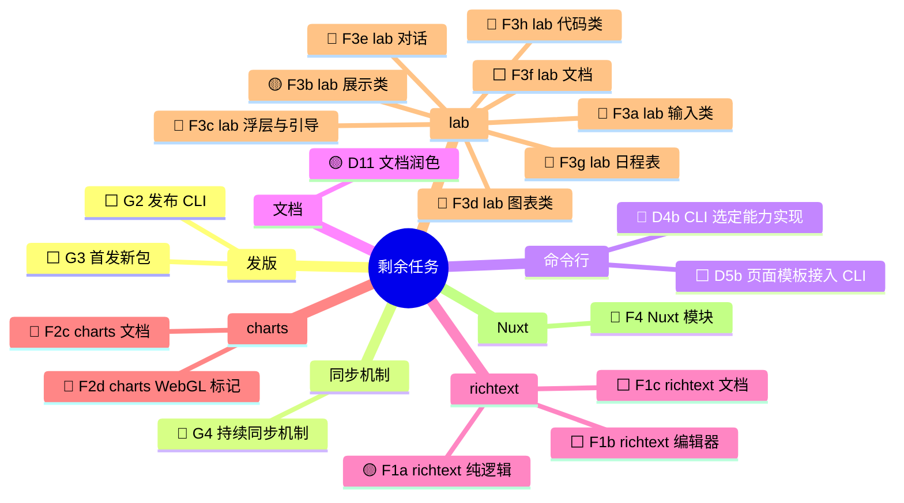

## 背景

[#128](https://github.com/astryx-vue/astryx-vue/pull/128) 已经合入 `dev`。到那时，组件、七套主题、文档站、演练场 57 个模板都已对齐 Astryx v0.7.1，D10 的 core 遗留问题也修完了。

这个 PR（`swarm-tree` → `dev`）接着做剩下的任务：

- 命令行：D4b、D5b、G2。
- 新包：F 阶段和 G3。
- 持续同步：G4。

做法和 #128 一样：每个节点开小 PR 合进 `swarm-tree`，这个 PR 跟着更新。

**进度以 GitHub Project [astryx-vue 路线图](https://github.com/orgs/astryx-vue/projects/1) 为准。** 每个剩余节点各有一个 issue（#185–#204），节点 PR 写 `Closes #N`，合入后卡片自动进 Done。执行计划仍在 `.agents-work/upstream-sync-0.7.1/nodes/<ID>/plan.md`。`ROADMAP.md` 停在 2026-10-27，只作历史记录。

图例：🟡 进行中 · 🔵 可开工 · ⬜ 未开始（等依赖）。每个节点对应的 issue 见 Project。

> 这段描述由总控整篇覆盖，节点合入或状态变化时更新。不要在标记块外面再贴一份。

## 剩余任务

依赖关系：

- G2 要等 D4b 和 D5b。D4a 已经定稿：`init`、`theme`、`upgrade` 只输出指引，`doctor` 只报告不修改。
- G3 要等 F1c、F2c、F3f、F4 都完成。

## 当前在做

- **F1a richtext 纯逻辑** #188：新建 `@astryx-vue/richtext`，移植 Markdown 往返逻辑。
- **F3b lab 展示类** #194：新建 `@astryx-vue/lab`（canary），移植 Stat、CircularProgress、InfoTip、SVGIcon、LogStream。
- **D11 文档润色** #204：document-writer 润色中文指南和主题页（第 1 批），有脚本核对代码、链接、结构没被改动。
- **G4 持续同步** #203：计划已写好（`nodes/G4/plan.md`），等有空位就派。上游已经到 v0.7.4，比 v0.7.1 多 312 个提交。

## 已合入本 PR 的节点

| 节点 | PR | 说明 |
| --- | --- | --- |
| G1 发布 core + themes 0.4.0 | [#182](https://github.com/astryx-vue/astryx-vue/pull/182) [#183](https://github.com/astryx-vue/astryx-vue/pull/183) [#184](https://github.com/astryx-vue/astryx-vue/pull/184) | `@astryx-vue/core`、`@astryx-vue/themes` 0.4.0 已发布到 npm（latest），对齐 Astryx v0.7.1。GitHub Release、GitHub Packages 和 main→dev 回同步都已完成 |
