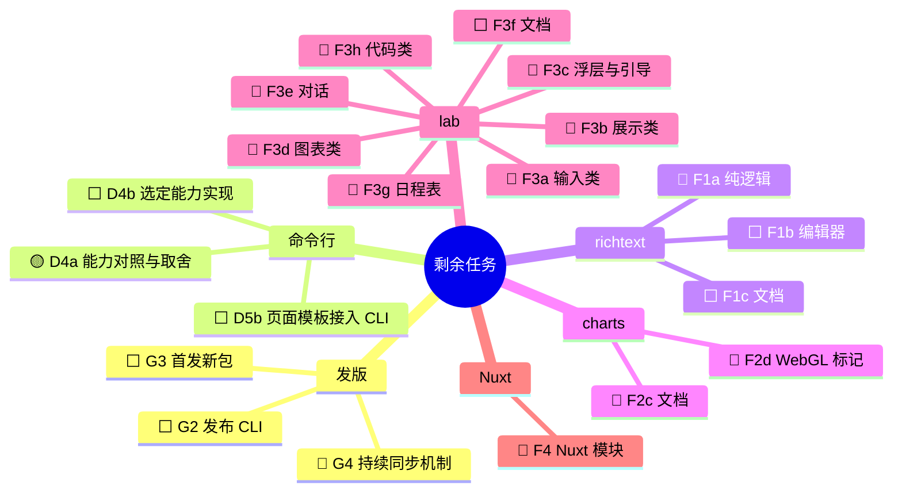

## 背景

[#128](https://github.com/astryx-vue/astryx-vue/pull/128) 已经合入 `dev`。到那时，组件、七套主题、文档站、演练场 57 个模板都已对齐 Astryx v0.7.1，D10 的 core 遗留问题也修完了。

这个 PR（`swarm-tree` → `dev`）接着做剩下的任务：

- 命令行：D4a、D4b、D5b、G2。
- 新包：F 阶段和 G3。
- 持续同步：G4。

做法和 #128 一样：每个节点开小 PR 合进 `swarm-tree`，这个 PR 跟着更新。

进度以 `.agents-work/upstream-sync-0.7.1/` 为准（`ROADMAP.md`、`HANDOFF.md`、`nodes/<ID>/`）。

图例：🟡 进行中 · 🔵 可开工 · ⬜ 未开始

> 这段描述由总控整篇覆盖，节点合入或状态变化时更新。不要在标记块外面再贴一份。

## 剩余任务

依赖关系：

- G2 还要等 D4b 和 D5b；D4b 要等 D4a 和用户定下取舍。
- G3 要等 F1c、F2c、F3f、F4 都完成。

## 当前在做

- **D4a 命令行取舍。** 还剩 `upgrade` 命令的形态没定，在和用户边讨论边定，记录在 `nodes/D4a/decisions.md`。

## 已合入本 PR 的节点

| 节点 | PR | 说明 |
| --- | --- | --- |
| G1 发布 core + themes 0.4.0 | [#182](https://github.com/astryx-vue/astryx-vue/pull/182) [#183](https://github.com/astryx-vue/astryx-vue/pull/183) [#184](https://github.com/astryx-vue/astryx-vue/pull/184) | `@astryx-vue/core`、`@astryx-vue/themes` 0.4.0 已发布到 npm（latest），对齐 Astryx v0.7.1。GitHub Release、GitHub Packages 和 main→dev 回同步都已完成 |
