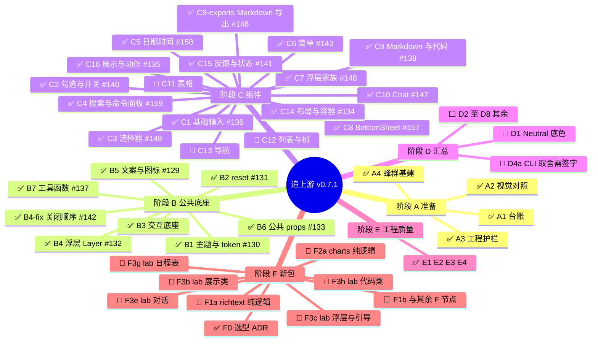

## 背景

astryx-vue 是用 Vue 3 重新实现 [Astryx](https://github.com/facebook/astryx) 设计语言的非官方移植（CSS 变量 / cascade layers、组件粒度、应用模式），不照搬 React，也不要求消费者依赖 StyleX。

上游已经发布到 **v0.7.1**，我们这边此前大致停在 0.4.x 一代的能力面上。这个 Draft PR（`swarm-tree` → `dev`）是一次有计划的追齐：把 `96f9917f..v0.7.1` 的上游差异拆成一棵任务树，逐节点实现、验收、合入 `swarm-tree`；树走完、迁移说明就绪后，再合进 `dev` / `main` 发版。

协作方式（蜂群）：

- 每个节点：实现者写代码，验收者按 `verify.md` 独立验收（界面节点要浏览器对照截图，截图不进 git）。
- 用户说「合」后，节点 PR 合进 `swarm-tree`；本总 PR 会自动更新并重新部署文档预览，方便从用户视角验收。
- 进度唯一来源：`.agents-work/upstream-sync-0.7.1/`（`ROADMAP.md` / `SWARM.md` / `ledger/` / `nodes/<ID>/`）。

图例：✅已完成 · 🟡实现中 · 🔷验收中 · 🔵可开工 · ⬜未开始

> 本描述会在节点合入或状态变更时由总控整篇覆盖。不要在标记块外再贴一份，否则会叠成重复的两段。**已合入节点表要保留完整历史**（节点 / PR / 验收结果），只在表头追加新行，不要改成只留「本轮」。

## 进度（mindmap）

## 已合入 `swarm-tree` 的节点 PR

| 节点 | PR | 说明 |
| --- | --- | --- |
| C4 搜索与命令面板 | [#159](https://github.com/astryx-vue/astryx-vue/pull/159) | squash 合入 `swarm-tree`（`cb8c3e12`）。验收通过 23/23 |
| C5 日期时间家族 | [#158](https://github.com/astryx-vue/astryx-vue/pull/158) | squash 合入 `swarm-tree`（`27e43c5e`）。验收通过 23/23；返工 1 轮，补了 touch 路径的 change 与 `isReadOnly` 锁 |
| C8 BottomSheet | [#157](https://github.com/astryx-vue/astryx-vue/pull/157) | squash 合入 `swarm-tree`（`56fee620`）。验收通过 21/21。默认内边距交给内容区，拖动手势已拆开 |
| 子菜单 SSR、catalog 门禁、浮层 window | [#156](https://github.com/astryx-vue/astryx-vue/pull/156) | 不是总表节点。收掉 `HTMLElement is not defined`、当时过期的 catalog，以及 `window is not defined`（`dd1967e`） |
| C10 Chat | [#147](https://github.com/astryx-vue/astryx-vue/pull/147) | 第 2 轮通过。Enter 选中当前高亮项；空草稿时发送按钮禁用 |
| C3 选择器家族 | [#149](https://github.com/astryx-vue/astryx-vue/pull/149) | 第 3 轮通过 21/21。Escape 后焦点回到触发器 |
| C7 浮层家族 | [#148](https://github.com/astryx-vue/astryx-vue/pull/148) | 通过 24/24。对话框页眉换肤、悬停卡片、轻提示滑动；滚动锁仍不钉 `position: fixed` |
| C9-exports Markdown 子路径 | [#146](https://github.com/astryx-vue/astryx-vue/pull/146) | 不是总表节点。通过 10/10。构建产出 `parser`、`plugins`、`plugin-renderer` 的 dist |
| C15 反馈与状态 | [#141](https://github.com/astryx-vue/astryx-vue/pull/141) | 通过 26/26。提示条、加载圈、进度条、步骤条对齐上游 |
| B4-fix 关闭顺序 | [#142](https://github.com/astryx-vue/astryx-vue/pull/142) | 不是总表节点。Escape 只关最上面一层，补上嵌套深度，并刷新 CLI catalog |
| C6 菜单家族 | [#143](https://github.com/astryx-vue/astryx-vue/pull/143) | 通过 26/26。按压打开、悬停飞出、Escape 只关最上面一层 |
| C2 勾选与开关 | [#140](https://github.com/astryx-vue/astryx-vue/pull/140) | 通过 20/20。勾选、单选、开关、滑块、分段，对齐上游 v0.7.1 |
| C9 Markdown 与代码 | [#138](https://github.com/astryx-vue/astryx-vue/pull/138) | 第 2 轮通过 28/28。子路径 dist 已由 C9-exports #146 补上 |
| B7 工具函数 | [#137](https://github.com/astryx-vue/astryx-vue/pull/137) | 通过 25/25。时间、日期、可见字符、安全地址等 utils |
| C1 基础输入 | [#136](https://github.com/astryx-vue/astryx-vue/pull/136) | 通过 22/22。FR10 分层、`isLabelHidden`、数字提交与字数 |
| C16 基础展示与动作 | [#135](https://github.com/astryx-vue/astryx-vue/pull/135) | 通过 15/15。触屏按压、安全 URL、ButtonGroup 漫游焦点、头像重叠 |
| C14 布局与容器 | [#134](https://github.com/astryx-vue/astryx-vue/pull/134) | 通过 28/28。Resizable、Toolbar、Card 等 |
| B1–B6 | #129–#133 | 主题、reset、交互、浮层、文案图标、公共 props。B3 合在 `swarm-tree` 上，没有单独的节点 PR 号 |

## 当前并行

没有正在实现或验收的节点。

可以开工、等待派发：C11、C12、C13、D1、F2a、D4a、F1a、F3b、F3g、F3c、F3h、F3e。D4a 仍要等用户签字，签字前不要派。C8 合入后 F3a 仍要等 C11、C12，保持未开始。

**本 PR 的 CI：** 当前 tip 含 C4（`cb8c3e12`）。节点 PR 合入前仍须 Check + Test 绿。#156 已收掉子菜单 SSR、catalog 门禁与浮层 window 问题。

## 怎么验收这个总 PR

- 文档预览随 `swarm-tree` 更新自动部署（节点合向 `swarm-tree` 的小 PR 本身不部署）。
- 对照原版：[Astryx](https://astryx.atmeta.com) 和本预览站；桌面 / 390px，浅色 / 深色。左右对照必须是同一处 Demo（#151 已合入这条规则）。
- 细项证据在各节点 `nodes/<ID>/verify-N.md`。对齐的是观感和手感，不是 React 一行对一行。
