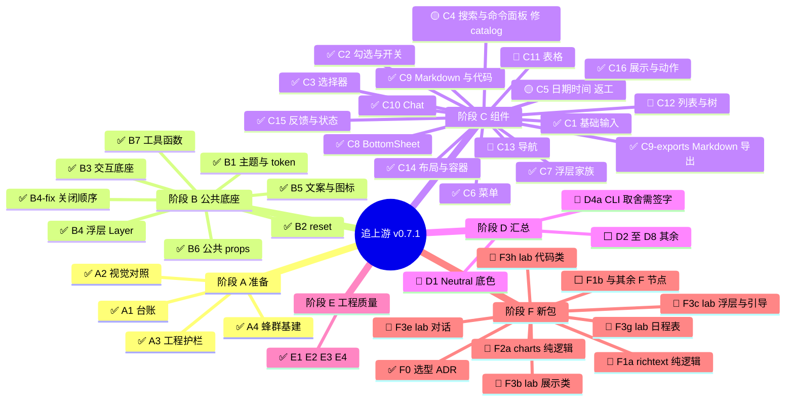

## 背景

astryx-vue 正在追上游 [Astryx](https://github.com/facebook/astryx) v0.7.1。这个 Draft PR 的方向是 `swarm-tree` → `dev`：节点先合进 `swarm-tree`，任务树走完、迁移说明就绪后再进 `dev`。

图例：✅已完成 · 🟡实现中 · 🔷验收中 · 🔵可开工 · ⬜未开始

> 本描述由总控整篇覆盖。不要在标记块外再贴一份，也不要把旧表接在后面。

## 进度

## 本轮已合入

| 节点 | PR | 说明 |
| --- | --- | --- |
| C8 BottomSheet | [#157](https://github.com/astryx-vue/astryx-vue/pull/157) | squash 合入 `swarm-tree`（`56fee620`）。验收通过 21/21。默认内边距交给内容区，拖动手势已拆开 |
| 子菜单 SSR、catalog 门禁、浮层 window | [#156](https://github.com/astryx-vue/astryx-vue/pull/156) | 不是总表节点。收掉 `HTMLElement is not defined`、当时过期的 catalog，以及 `window is not defined` |

## 当前并行

| 节点 | PR | 状态 |
| --- | --- | --- |
| C5 日期时间家族 | [#158](https://github.com/astryx-vue/astryx-vue/pull/158) | 返工。touch 路径的 change 没有触发，`isReadOnly` 漏锁 |
| C4 搜索与命令面板 | [#159](https://github.com/astryx-vue/astryx-vue/pull/159) | 修 catalog 与冲突，CI 还在修 |

可以开工、等待派发：C11、C12、C13、D1、F1a、F2a、F3b、F3c、F3e、F3g、F3h。C8 合入后 F3a 仍要等 C11、C12，保持未开始。D4a 仍要等用户签字，签字前不要派。
