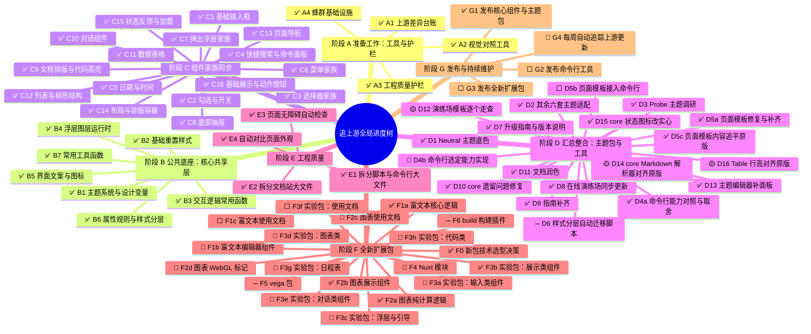
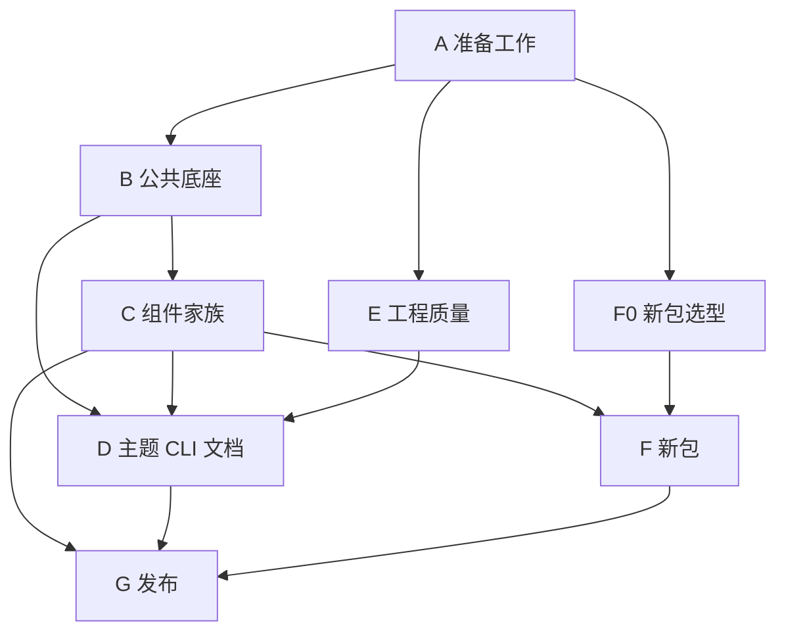
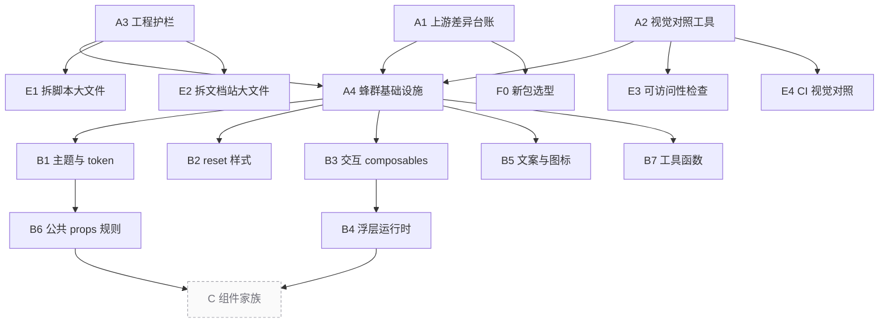
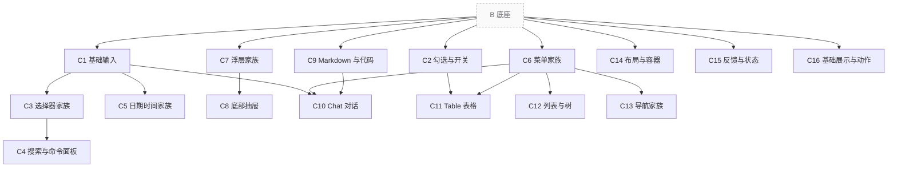
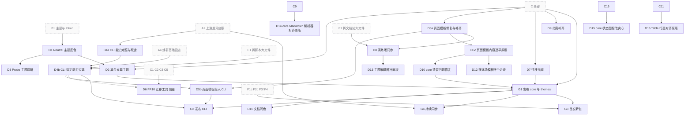
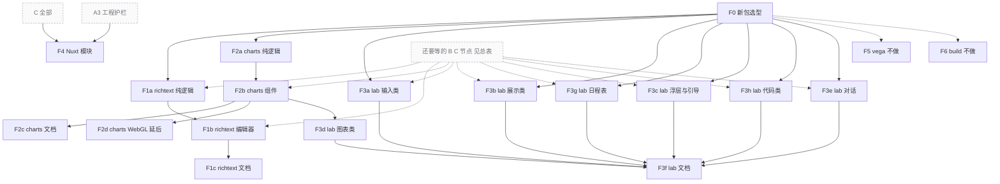

# 追上游任务地图与实时进度

> 这份文档是唯一的进度看板。所有的任务状态都在这里更新。
> 怎么分工派活、怎么检查验收，请看 `SWARM.md`。

## 全局进度树状图

### 状态图例

- ⬜ 未开始：前面还有没做完的任务，暂时不能动手。
- 🔵 可开工：前置任务全做完了，等待总控派发任务。
- 🟡 实现中：负责写代码的子代理正在开发。
- 🟣 待验收：代码写完了，等待验收者检查。
- 🔷 验收中：负责检查的子代理正在用浏览器验证。
- 🔴 返工中：检查没通过，退回重新修改。
- 🟠 待用户决定：连续 3 次没通过，暂停等待用户拿主意。
- ✅ 已完成：检查通过，总控复核过，代码已合入 `swarm-tree` 分支。
- ➖ 不做：经过评估决定不需要移植。

---

## 名词小词典

| 词汇 | 大白话解释 |
| --- | --- |
| 上游 (upstream) | 源头项目。这里指 Meta 公司用 React 写的原版设计系统代码。 |
| 下游 | 跟随源头改造的项目。这里指我们正在做的 Vue 3 移植版本。 |
| token (设计变量) | 给颜色、间距起的名字。比如主色调、中等间距。改一处名字，全套界面跟着变。 |
| rem | 相对长度单位。尺寸会跟着网页根字号等比例缩放。 |
| composable | Vue 组合式函数。把常用的交互逻辑抽出来做成积木，比如 `useXxx`。 |
| SSR (服务端渲染) | 网页先在后台服务器拼好骨架，再发给浏览器。这样打开网页更快。 |
| FR10 | 上游组件规范里的第 10 条要求。它规定输入类组件的样式要分两层设置：外框叫 container，里面的控件叫 control。 |
| theme target (换肤挂载点) | 组件上预留的挂钩。方便精确定位并单独替换某个部位的样式。 |
| Layer (图层运行时) | 页面里漂浮在最上层的图层管理器。专门管弹窗、下拉菜单和气泡提示。 |
| codemod | 自动改代码的小工具。能帮开发者自动把老代码升级成新写法。 |
| worktree (git 工作区) | 同一个代码仓库可以在不同文件夹同时切不同分支干活，互不打扰。 |
| changeset | 版本发布记录工具。自动管理版本号和更新日志的小帮手。 |
| 蜂群 (swarm) | 多个 AI 协同工作的模式。主会话当总指挥，派多个 AI 子代理去干活。 |

---

## 为什么做这件事与背景数据

astryx-vue 是把 Meta 公司的 React 设计系统改写成 Vue 3 的版本。

- 本仓库当前对齐的上游版本：`0.4.1`（Git 提交号 `96f9917f`）。
- 本轮目标：完全跟进到上游正式标签 `v0.7.1`。
- 上游 main 分支之后的新提交，留给 G4 节点的每周自动化同步机制处理。
- 两个版本之间上游一共有 1693 个提交：
  - 805 个改了核心组件库 `core`。
  - 418 个改了命令行工具 `cli`。
  - 71 个改了主题包 `themes`。
- 上游还有几个我们尚未移植的新扩展包：
  - `richtext`：基于 Lexical 的富文本编辑器。
  - `charts`：图表展示库。
  - `lab`：19 个实验性组件（上游只发 canary 测试版）。
  - `vega`：数据可视化包（上游只发 canary 测试版）。
  - `build`：StyleX 专用的样式构建插件。

核心库 `core` 中改动最多的部分（按上游提交数统计）：

| 模块或组件 | 提交数 | 模块或组件 | 提交数 |
| --- | --- | --- | --- |
| Markdown | 299 | DropdownMenu | 203 |
| Chat | 183 | theme | 160 |
| Table | 154 | BottomSheet | 139 |
| Selector | 133 | hooks | 131 |
| DateInput | 98 | MultiSelector | 91 |

---

## 任务前后依赖关系图

箭头的意思是「前面的做完，后面的才能开工」。
节点太多，画在一张图里会缠成一团，所以先看阶段总览，再分四张小图看细节。
灰色虚线框是别的图里的节点，只是在这里露个面。每个节点完整的依赖，以后面的「当前状态总表」为准。

### 总览：阶段之间的先后

### 图一：准备工作与公共底座

### 图二：组件家族

「B 底座」代表 B1 到 B7，每个 C 节点具体要哪几个，看状态总表。

### 图三：主题、CLI、文档与发布

「C 全部」表示 C1 到 C16 都做完。

### 图四：新包

---

## 协作规则与完成标准

### 任务最小单元

整个地图分三层：**阶段 → 任务树节点 → 检查项**。
**任务树节点**是最小管理单位。每个节点由两个不同的子代理配合完成：

1. **实现者**（固定使用 `sub2tok/claude-sonnet-5-5`）：按照总控写好的 `plan.md` 动手改代码。
2. **验收者**（固定使用 `sub2tok/claude-sonnet-5-5`）：按照总控写好的 `verify.md` 逐项检查，必须打开浏览器亲眼看。

### 推进原则

1. **没有验收者点头不算做完**：必须拿到 Sonnet 验收者的「通过」结论。依赖它的下游节点才能变成「可开工」。
2. **返工不卡别人**：某个节点没通过，只在它自己的分支上反复修改，不影响其他平行的任务。
3. **达标才能交卷**：通用完成标准全满足、`verify.md` 每项都通过、总控亲自复核完毕，才能改成「已完成」。
4. **范围不对先汇报**：做到一半发现改动范围不对，立刻向总控汇报，由总控改地图。子代理不要擅自扩大或缩小范围。
5. **机器资源有上限**：同一时间最多 3 个活跃子代理、最多 2 个浏览器窗口，具体看 `SWARM.md`。

### 对齐的标准

要和上游保持一致的是**视觉效果和交互体验**，代码不需要和上游逐行对应。可以采用更适合 Vue 的写法，前提是最终效果一样。详细规则见 `SWARM.md` 的「对齐上游的标准：看效果，不看代码」。

### 通用完成标准（每个节点都必须做到）

- 从 `swarm-tree` 分支拉新分支，命名为 `sync/<节点ID小写>-<简短名>`。验收通过后由总控合回 `swarm-tree`。
- 终端运行 `pnpm check` 必须全绿通过，不能有任何报错。
- 本节点修改的源码文件，单文件不能超过 500 行。如果改到了原来就超标的文件，顺手拆成小文件。
- 不要手动修改自动生成的文件。改完后运行 `pnpm sync` 重新生成。
- 只要改到了组件外观或交互，PR 里必须附上 4 种外观对比截图：桌面端与 390px 手机窄屏、浅色模式与深色模式。左右对照必须是同一组件、同一 Demo 区块标题、同一滚动位置、同一交互状态；原版只截 Overview 里的 Demo，不截 Guidance / Practices；本地是能看到侧栏的 VitePress 文档站整页。没有对位就写「无对位」并改发单侧整页，禁止把无关区块拼成对照图。细则见 `SWARM.md`「发给用户的验收对照图」。
- 凡是用到了 A1 差异台账的节点，台账里属于本节点的每一项，都要标为「已采纳」或注明「不适用及理由」，不能留空。

---

## 当前状态总表

| 节点 | 名称 | 依赖 | 状态 | 轮次 | 实现者 | 验收者 | 最近验收结论 | PR |
| --- | --- | --- | --- | --- | --- | --- | --- | --- |
| A1 | 上游差异台账 | — | ✅ 已完成 | 1 | A1-impl | A1-verify | 通过 21/21 | 11ddc15 |
| A2 | 视觉对照工具 | — | ✅ 已完成 | 1 | A2-impl | A2-verify | 通过 24/24 | 8d35ed7 |
| A3 | 工程护栏 | — | ✅ 已完成 | 2 | A3-impl-r2 | A3-verify-r2 | 第 2 轮通过 26/26，两种模式都通过 | 163f333 9a1d2f2 |
| A4 | 蜂群基础设施 | A1 A2 A3 | ✅ 已完成 | 2 | A4-impl-r2 | A4-verify-r2 | 第 2 轮通过 33/33 | 00fd7d0 |
| B1 | 主题系统与 token | A4 | ✅ 已完成 | 3 | orchestrator | B1-verify-r4 | 复查通过（第 3 轮后总控改文档） | #130 |
| B2 | reset 与基础样式 | A4 | ✅ 已完成 | 1 | B2-impl | orchestrator | 通过 19/19（总控补完） | #131 |
| B3 | 交互底座 composables | A4 | ✅ 已完成 | 1 | B3-impl | B3-verify | 通过 17/17 | 2b22513 |
| B4 | 浮层运行时 Layer | B3 | ✅ 已完成 | 4 | B4-impl-r3 | orchestrator | 第 4 轮通过（总控） | #132 |
| B5 | 文案与图标 | A4 | ✅ 已完成 | 3 | B5-impl-r3 | B5-verify-r3 | 第 3 轮通过 | #129 |
| B6 | 公共 props 规则 | B1 | ✅ 已完成 | 1 | B6-impl | orchestrator | 通过 15/15（总控） | #133 |
| B7 | 工具函数 utils | A4 | ✅ 已完成 | 1 | B7-impl | | 通过 25/25 | #137 |
| C1 | 基础输入 | B1 B2 B3 B5 B6 | ✅ 已完成 | 1 | | | 通过 22/22 | #136 |
| C2 | 勾选与开关 | B3 B6 | ✅ 已完成 | 1 | | | 通过 20/20 | #140 |
| C3 | 选择器家族 | C1 B4 | ✅ 已完成 | 3 | C3-impl | | 第 3 轮通过 21/21；Escape 焦点回触发器 | #149 |
| C4 | PowerSearch / CommandPalette | C3 | ✅ 已完成 | 1 | | | 通过 23/23 | #159 |
| C5 | 日期时间家族 | C1 B4 B7 | ✅ 已完成 | 2 | | | 第 2 轮通过 23/23；返工 1 轮，补了 touch change 与 isReadOnly 锁 | #158 |
| C6 | 菜单家族 | B3 B4 B6 | ✅ 已完成 | 1 | | | 通过 26/26 | #143 |
| C7 | 浮层家族 | B4 B6 | ✅ 已完成 | 1 | C7-impl | | 通过 24/24 | #148 |
| C8 | BottomSheet | C7 | ✅ 已完成 | 1 | | | 通过 21/21 | #157 |
| C9 | Markdown 与代码 | B1 B2 | ✅ 已完成 | 2 | C9-impl | | 第 2 轮通过 28/28 | #138 |
| C10 | Chat | C9 C6 C1 | ✅ 已完成 | 2 | C10-impl | | 第 2 轮通过：Enter 高亮项，空草稿发送禁用 | #147 |
| C11 | Table | C2 C6 | ✅ 已完成 | 0 | | | 通过 21/21 | #162 |
| C12 | 列表与树 | B3 C6 | ✅ 已完成 | 0 | | | 第 3 轮通过 27/27 | #161 |
| C13 | 导航家族 | B4 C6 | ✅ 已完成 | 0 | | | 通过 24/24，总控复核补了标签条滚动、触屏按压、面包屑当前页 | #163 |
| C14 | 布局与容器 | B1 B3 B6 | ✅ 已完成 | 1 | | | 通过 28/28 | #134 |
| C15 | 反馈与状态 | B1 B6 | ✅ 已完成 | 2 | | | 通过 26/26 | #141 |
| C16 | 基础展示与动作 | B1 B3 B5 B6 | ✅ 已完成 | 1 | | | 通过 15/15（文档补 Ghost） | #135 |
| D1 | Neutral 主题底色 | B1 | ✅ 已完成 | 1 | D1-impl | | 总控复核通过，补了 Heading/Text 读行高字重 | #165 |
| D2 | 其余 6 套主题适配 | D1 C全部 | ✅ 已完成 | 1 | D2-impl | | 6 套主题 token 与组件覆盖值全部对齐上游；core 新增变量入口默认值不变 | #169 |
| D3 | Probe 主题调研 | D1 | ✅ 已完成 | 0 | | | 调研结论：probe 是上游测试夹具，不移植 | nodes/D3/conclusion.md |
| D4a | CLI 能力对照与取舍 | A1 | ✅ 已完成 | 1 | 总控+用户讨论 | | CLI 中等规模；init/theme/upgrade 只输出指引；doctor 只报告；D4b 范围定稿 | |
| D4b | CLI 选定能力实现 | D4a A4 E1 | 🔵 可开工 | 0 | | | | |
| D5a | 页面模板修复与补齐 | C全部 | ✅ 已完成 | 1 | D5a-impl | | 补 160 处变量前缀并加检查；settings-dialog 版式；补 4 个模板与 50 张演示图片；原版未完成模板只能链接打开 | #171 |
| D5c | 页面模板内容追平原版 | D5a | ✅ 已完成 | 3 | D5c-impl | | 57 个模板逐个和原版截图对照；修 3 处插槽名，29 个模板追平原版；演练场图表按容器宽度绘制 | #175 #177 #178 |
| D5b | 页面模板接入 CLI | D5a D4b | ⬜ 未开始 | 0 | | | | |
| D6 | FR10 迁移 codemod | D4b C1 C2 C3 C5 | ➖ 不做 | 0 | | | 用户 2026-10-26 决定暂缓：根上的 class 保持原落点，升级不改也不坏；迁移说明已在 D7 升级指南 | |
| D7 | 迁移指南与版本信息 | C全部 | ✅ 已完成 | 1 | D7-impl | | 总控复核通过，修正 3 处说法 | #167 |
| D9 | 指南补齐 | C全部 | ✅ 已完成 | 1 | D9-impl | | 补 4 个新指南页与 6 处小节，中英文各一份 | #172 |
| D10 | core 遗留问题修复 | D5c | ✅ 已完成 | 1 | D10-impl | | Stack 间距不再继承；Table 列头筛选同行、行级 ref 与事件；Selector 图标组件化；竖向 Step 内容；两个 Table 组合式函数 config 支持 ref | #180 |
| D11 | 文档润色 | G1 | ✅ 已完成 | 3 | D11-writer | | 第 1 批：中文指南和主题页 39 处宣传腔改平实；组件页和英文页留后续批次 | #213 |
| D12 | 演练场模板逐个走查 | D5c | 🟡 实现中 | 2 | D12-ui | | | |
| D13 | 主题编辑器补面板 | D8 | ✅ 已完成 | 1 | D13-ui | | Components、Advanced 两个面板补齐，实时预览、导出、分享恢复；新增 14 测试 | #212 |
| D14 | core Markdown 解析器对齐原版 | C9 | 🟡 实现中 | 1 | D14-impl | | | |
| D15 | core 状态图标改实心 | C16 | ✅ 已完成 | 2 | D15-impl | | 状态图标走 Icon：文档站 lucide 描边、演练场实心兜底，与原版两处一致 | #214 |
| D16 | Table 行高对齐原版 | C11 | 🟡 实现中 | 1 | 总控 | | | |
| D8 | 演练场同步 | D5a E2 | ✅ 已完成 | 1 | D8-impl | | 预览通道按 nonce 校验来源；三种启动失败都有提示；57 个模板预览 0 报错 | #174 |
| E1 | 拆分脚本与 CLI 生成器大文件 | A3 | ✅ 已完成 | 1 | E1-impl | E1-verify | 通过 16/16 | e41828a |
| E2 | 拆分文档站大文件 | A3 | ✅ 已完成 | 1 | E2-impl | E2-verify | 通过 22/22 | 46a0e25 |
| E3 | 可访问性自动检查 | A2 | ✅ 已完成 | 1 | E3-impl | E3-verify | 通过 20/20 | 09c400b |
| E4 | CI 接入视觉对照 | A2 | ✅ 已完成 | 1 | E4-impl | E4-verify | 通过 22/22 | a5fcfe5 |
| F0 | 新包选型决策 | A1 | ✅ 已完成 | 2 | F0-impl-r2 | F0-verify-r2 | 第 2 轮通过 17/17 | e48b073 |
| F1a | richtext 纯逻辑 | F0 C9 | ✅ 已完成 | 1 | F1a-impl | | 新建 richtext 包，Markdown 往返 420 测试；12 todo 等 D14 修 core 解析器 | #208 |
| F1b | richtext 编辑器 | F1a C1 C2 C3 C7 C14 C16 | 🔵 可开工 | 0 | | | | |
| F1c | richtext 文档 | F1b | ⬜ 未开始 | 0 | | | | |
| F2a | charts 纯逻辑 | F0 B1 | ✅ 已完成 | 1 | F2a-impl | | 总控复核通过，113 条测试，上游断言逐条一致 | #166 |
| F2b | charts 组件 | F2a B7 C7 C14 C16 | ✅ 已完成 | 1 | F2b-impl | | Chart/Axis/Grid/Legend/Swatch/Tooltip 与 8 种 SVG 标记；上游用例除 WebGL 外全部移植 | #170 |
| F2c | charts 文档 | F2b | 🔵 可开工 | 0 | | | | |
| F2d | charts WebGL 标记 | F2b | 🔵 可开工 | 0 | | | 延后：等上游这部分成熟 | |
| F3a | lab 输入类 | F0 C3 C8 C11 C12 C14 C15 C16 | 🔵 可开工 | 0 | | | | |
| F3b | lab 展示类 | F0 C7 C16 | ✅ 已完成 | 1 | F3b-impl | | 新建 lab 包（canary），Stat/CircularProgress/InfoTip/SVGIcon/LogStream，85 测试 | #205 |
| F3g | lab 日程表 | F0 B7 C6 C7 C14 C15 C16 | 🔵 可开工 | 0 | | | | |
| F3c | lab 浮层与引导 | F0 C7 C14 C16 | 🔵 可开工 | 0 | | | | |
| F3d | lab 图表类 | F2b C16 | 🔵 可开工 | 0 | | | | |
| F3h | lab 代码类 | F0 C9 | 🔵 可开工 | 0 | | | | |
| F3e | lab 对话 | F0 C7 C10 | 🔵 可开工 | 0 | | | | |
| F3f | lab 文档 | F3a F3b F3g F3c F3d F3h F3e | ⬜ 未开始 | 0 | | | | |
| F4 | Nuxt 模块 | A3 C全部 | 🔵 可开工 | 0 | | | | |
| F5 | vega | F0 | ➖ 不做 | 0 | | | 见 ADR 0001 第 5 节 | |
| F6 | build | F0 | ➖ 不做 | 0 | | | 见 ADR 0001 第 6 节 | |
| G1 | 发布 core + themes | C全部 D2 D7 D10 | ✅ 已完成 | 1 | 总控 | | core 与 themes 0.4.0 已发 npm（latest），GitHub Release 与 GitHub Packages 同步 | #182 #183 #184 |
| G2 | 发布 CLI | G1 D4b D5b | ⬜ 未开始 | 0 | | | | |
| G3 | 首发新包 | G1 F1c F2c F3f F4 | ⬜ 未开始 | 0 | | | | |
| G4 | 持续同步机制 | A1 G1 | 🔵 可开工 | 0 | | | | |

C9-exports 不是总表节点，不要加进行。它已完成（#146，通过 10/10），修的是 Markdown 子路径 `parser`、`plugins`、`plugin-renderer` 的 dist 导出。

---

## 各阶段任务细节说明

### 阶段 A 准备工作：工具与护栏

| 节点 | 要做什么 | 依赖谁 | 怎么算做完 |
| --- | --- | --- | --- |
| A1 上游差异台账 | 编写脚本 `scripts/upstream-ledger.mjs`。传入两个上游提交号，把提交分门别类整理好（分成组件、交互函数、主题、命令行工具、其它）。找出每个提交的标题、是否有破坏性改动（带感叹号 `!`）、改了哪些说明文档和测试文件。按 C 阶段的节点归类，生成 `.agents-work/upstream-sync-0.7.1/ledger/<节点ID>.md` 检查清单，每条前面留勾选框。 | 无 | 上游每个提交至少进入一个节点账本，或被明确标为「无关」并写明理由；一个提交改到多个节点时，在每个相关节点里都列出，并标明还涉及哪些节点；归不进任何节点的文件数为 0；脚本自带单元测试；再跑一次结果逐字节相同。 |
| A2 视觉对照工具 | 用 Playwright 编写自动化截图脚本。输入组件名，同时打开上游和我们文档站的同款示例。在 桌面/390px手机窄屏 × 浅色/深色 共 4 种组合下截图，拼成左右对比图，并算出像素差异分数。 | 无 | 在 Button、Dialog、Selector 这 3 个组件上测试跑通；输出文件目录与命名规则固定；写清使用说明文档。 |
| A3 工程护栏 | ① 编写 500 行代码检查脚本，接进 `pnpm check`。当前已经超标的文件写入白名单，白名单只许减少不许增加。② 编写 SSR 服务端渲染冒烟测试：自动用 `renderToString` 渲染所有公开组件。当前报错的组件写入「已知失败名单」，名单只许减少不许增加。③ 给 `Resizable` 组件补齐自动化测试。 | 无 | 两份名单都能自动参与检查；只要新写代码单文件超过 500 行，`pnpm check` 就会直接报错拦截。 |
| A4 蜂群基础设施 | 把 `SWARM.md` 里的约定做成现成工具：① 提供 `plan.md` 和 `verify.md` 模板。② 浏览器互斥锁：A2 已经做好 `scripts/swarm/browser-lock.mjs`，这里把它推广到所有用浏览器的地方，并写清验收者手动开浏览器时怎么套上锁。③ 工作区脚本：编写 `scripts/swarm/worktree.mjs new\|rm <节点ID>`，自动分配槽位号和端口并安装好依赖。④ 状态脚本：编写 `scripts/swarm/status.mjs`，读取总表自动计算可开工节点并核对图例颜色。⑤ 明确多人修改自动生成文件的流程：先 rebase 再执行 `pnpm sync`，不手动合并。 | A1 A2 A3 | 总控能一键为任意 C 节点创建工作区、生成计划、派出子代理；同时启动 3 个浏览器任务时，第 3 个能自动排队等待。 |

---

### 阶段 B 公共底座：核心共享层

| 节点 | 要做什么 | 依赖谁 | 怎么算做完 |
| --- | --- | --- | --- |
| B1 主题系统与 token | 同步上游 `core/src/theme` 目录。间距 token 改为随根字号变化（rem 单位）；删除老主题兼容层；加入 data token 变量；实现 theme target 换肤机制；固定触屏和手机窄屏字号阶梯；实现 MediaTheme。 | A4 | 所有主题设计变量生效；旧兼容层彻底移除；单元测试全部通过；修改的文件不超行。 |
| B2 reset 与基础样式 | 更新全局基础样式 `reset.css`。覆盖范围扩大到 `::before`、`::after`、`::placeholder` 以及搜索输入框；设定输入框最小字号；支持 `until-found` 隐藏文本搜索。 | A4 | 基础样式覆盖完整；浏览器展示无样式冲突；测试通过。 |
| B3 交互底座 composables | 同步上游 `core/src/hooks` 目录。触屏按压模型（用统一的委托控制器代替 `:active` 伪类）；menuPress、menuHover、longPress 长按；焦点陷阱与焦点归还；列表和网格按键焦点；快捷键热键；屏幕阅读器语音播报；滚动归属、滚动条占位、滚动键盘委托；容器展开；自适应呈现；媒体模式。 | A4 | 所有交互底层函数迁移完成；单元测试覆盖健全。 |
| B4 浮层运行时 Layer | 升级页面顶层图层运行时。让图层运行时统一负责处理视口内边距（对应上游 AST-059），同步更新 `LayerProvider`。 | B3 | 弹窗和下拉浮层能正确避让屏幕安全区内边距；测试通过。 |
| B5 文案与图标 | 重新拉取上游的多语言翻译词条（运行 `scripts/vendor-astryx-locales.mjs`，上游提交号指定为 `v0.7.1`）；同步国际化改动；图标注册表强制要求必须包含 upload 上传图标。 | A4 | 多语言翻译词条更新完毕；图标注册表校验通过。 |
| B6 公共 props 规则 | 允许非表单组件透传自定义属性（上游 PR #7331）；搭建 FR10 样式分层机制（分为外壳 container\* 和内部 control\* 属性，本节点只搭机制）；彻底删除 0.6 版本标记废弃的 API；删除 `emptySearchResultsText` 公共废弃属性。 | B1 | 属性透传与样式分层机制生效；废弃 API 清理完毕。 |
| B7 工具函数 utils | 同步 `timeParser` 时间解析器等通用基础工具函数。 | A4 | 所有工具函数单元测试全绿通过。 |

---

### 阶段 C 组件家族同步

#### C 阶段每个节点都适用的 6 条通用验收清单

每个 C 阶段节点在交卷前，必须逐一确认满足以下 6 条：

1. 本节点的上游差异台账全部处理完毕（逐条标为已采纳或写明不适用理由）。
2. 上游新增或改动的测试用例，全部改写成 Vue 测试并跑通。
3. 中英文说明文档、交互示例代码、组件元数据 `meta.ts` 全部更新到位。
4. 本节点涉及的全部组件，必须从 SSR 服务端渲染的已知失败名单中移出。
5. 附带 4 种组合的视觉对比图（桌面/窄屏 × 浅色/深色）。做左右对照时，左右必须是同一组件、同一 Demo 区块标题、同一滚动位置、同一交互状态（开/关一致）；原版只截 Overview 里的 Demo，禁止截 Guidance / Practices；本地必须是能看到侧栏的 VitePress 文档站整页（390 宽时改为能看到顶栏上的「菜单」）。没有对位 Demo 就写「无对位」，改发单侧整页。禁止把无关区块拼成对照图。细则见 `SWARM.md`「发给用户的验收对照图」。
6. 改动到的超过 500 行的源码文件全部拆开，并从白名单中移出。

#### C 阶段组件细节清单

> **C 阶段全体的共同要求（来自 B2）**：上游规定禁用的控件一律显示默认指针 `default`，不用 `not-allowed`（#5335）。B2 已经改好了 Button。其余的由各自的 C 节点顺手改掉，并在浏览器里确认。涉及：command-palette（C11）、overflow-list（C12）、token（C3）、clickable-card（C10）、complex-selector（C3）、stepper（C13）、nav-menu（C12）。如果节点编号对不上，以组件实际所属的节点为准。

> **B4 留下的事（C3、C6、C7 开工前必读）**：所有浮层根都已经带上文字重置，守护测试 `layer/layerCss.test.ts` 也会拦住遗漏。以后新增或拆分浮层组件时，要做两件事：根元素加 `astryx-layer` 类，组件自己 import `layer.css`。`DropdownMenuContext` 还没在浮层边界截断，交给 C6。Dialog 打开后约 0.5 秒内点不到 Toast，这是一个取舍，交给 C7 评估。具体见 `nodes/B4/impl-2.md` 第 4 节和 `verify-4.md`。

| 节点 | 涵盖组件 | 要特别注意的事项 | 依赖谁 |
| --- | --- | --- | --- |
| C1 基础输入 | TextInput、TextArea、NumberInput、FileInput、InputGroup、InputClearButton、Field、FieldLabel、FieldStatus、FormLayout | 接入 FR10 破坏性改动（上游 PR #7336）；清除按钮增加无障碍提示文字。 | B1 B2 B3 B5 B6 |
| C2 勾选与开关 | CheckboxInput、CheckboxList、RadioList、Radio、Switch、Slider、SegmentedControl、ToggleButton | 接入部分 FR10 改动（上游 PR #7339）。 | B3 B6 |
| C3 选择器家族 | Selector、MultiSelector、ComplexSelector、Typeahead、Tokenizer | 接入 FR10 改动（上游 PR #7341）；**用户报告的 bug**：演练场 `settings` 模板顶部的 Typeahead 写的是上游的 `is-label-hidden`，而我们的属性叫 `labelHidden`，结果「Search」标签照样显示出来，把 Settings 标题挤得折行（origin/dev 上就已经存在）。原因是隐藏标签的属性名在各组件里不统一：Selector、NumberInput、DateInput 用 `isLabelHidden`，Typeahead、Tokenizer、MultiSelector 用 `labelHidden`。C1、C3 都要把属性名统一成上游的 `isLabelHidden`（旧名 `labelHidden` 暂时保留为别名，并写进 D7 迁移指南），然后在浏览器里打开所有用到 `is-label-hidden` 的演练场模板，确认标签都已经隐藏、标题不再折行；支持 secondary 次要样式；支持 hasCreate 新建选项；支持 trigger 触发器自定义插槽；完善选项操作；主动拆分大文件 `MultiSelector.vue` 和 `Selector.vue`。`4672361` 用删空行躲开了行数白名单，必须真的拆开。 | C1 B4 |
| C4 PowerSearch / CommandPalette | PowerSearch、CommandPalette | 接入破坏性改动（上游 PR #7347）；主动拆分大文件 `PowerSearch.vue`。`4672361` 用删空行躲开了行数白名单，必须真的拆开。 | C3 |
| C5 日期时间家族 | Calendar、DateInput、DateRangeInput、DateTimeInput、TimeInput、Timestamp、Timer | 接入 FR10 改动（上游 PR #7337）；根据鼠标或触屏类型智能切换选择器（上游 PR #5243）；新增 presentation 展现模式属性。 | C1 B4 B7 |
| C6 菜单家族 | DropdownMenu、ContextMenu、MoreMenu | 增加 DropdownMenuGroup 分组组件；手机触屏支持子菜单逐级滑入；鼠标滑动支持安全三角区防误触；方向键循环与按字母快速跳转；菜单行支持真实链接跳转；主动拆分大文件 `DropdownMenu.vue` 和 `types.ts`。 | B3 B4 B6 |
| C7 浮层家族 | Dialog、AlertDialog、Popover、HoverCard、Tooltip、Lightbox、Toast | DialogHeader 增加 theme target 换肤挂载点；决定 `useScrollLock` 要不要照上游改成 `position:fixed`（上游是为了 iOS Safari，会影响打开浮层时的滚动位置，见 `nodes/B3/impl-1.md` 第 6 节）；主动拆分大文件 `useHoverCard.ts`。`resolveLayerMountTarget` 和 `isTopLayer` 必须接入或删除。 | B4 B6 |
| C8 BottomSheet | BottomSheet | 默认自带页面内边距（上游 PR #6884）；主动拆分大文件 `useSheetGestures.ts`。 | C7 |
| C9 Markdown 与代码 | Markdown、CodeBlock、Code | 标题自动生成跳转锚点；嵌套多层列表展示不同标记符号；字符实体引用解码；源码行号标记插件；超长代码行自动折行；代码 diff 对比层（上游 PR #7389）；主动拆分大文件 `render.ts`；清理 `tokenizer.ts` 里残留的 TODO 事项。**必做**：Markdown 解析器要提供和上游一样的接口，包括 `parseMarkdownAst`、`parseInlineAst`、`decodeMarkdownCharacterReferences`，以及插件能力协议，因为 F1a richtext 有 26 个测试依赖它们（见 ADR 0001 第 2.7 节）。 | B1 B2 |
| C10 Chat | Chat 全家族 | 输入框支持连续输入多个关键词触发补全；主动拆分大文件 `Chat/types.ts`。 | C9 C6 C1 |
| C11 Table | Table 全家族 | 表格行展开行为与其他插件统一对齐；支持按选中项批量执行操作；主动拆分大文件 `TableData.vue`。 | C2 C6 |
| C12 列表与树 | List、Item、TreeList、Outline、OverflowList、MetadataList | Item 列表项支持在手机上左右滑动操作（对应上游 AST-057）。 | B3 C6 |
| C13 导航家族 | SideNav、TopNav、MobileNav、NavMenu、NavItem、NavIcon、Breadcrumbs、TabList、Pagination | 同步上游关于页面框架导航、面包屑与分页器的全部更新。 | B4 C6 |
| C14 布局与容器 | AppShell、Layout、Grid、Stack、Center、AspectRatio、Section、ScrollableArea、Resizable、Collapsible、Card、ClickableCard、SelectableCard、Toolbar、Divider | 重点同步 Resizable 调整大小组件的 61 处改动。A3 已查出它和上游的 8 处差距，必须全部处理，见 `nodes/A3/impl-1.md` 第 4 节。其中「使用者绑定的 `@keydown` 不会被调用」像是 bug。 | B1 B3 B6 |
| C15 反馈与状态 | Banner、Spinner、ProgressBar、Indicator、StatusDot、Skeleton、Stepper、EmptyState | Banner 默认直接展开展示内容，折叠功能改为显式声明 `collapsible` 属性（上游 PR #5255）。 | B1 B6 |
| C16 基础展示与动作 | Button、ButtonGroup、IconButton、Link、Avatar、AvatarGroup、Badge、Token、Thumbnail、Kbd、Citation、Carousel、Heading、Text、Blockquote、Icon | 全面接入 B3 节点做好的触屏统一按压模型。 | B1 B3 B5 B6 |

---

### 阶段 D 汇总整合：主题包、CLI、文档

| 节点 | 要做什么 | 依赖谁 | 怎么算做完 |
| --- | --- | --- | --- |
| D1 Neutral 主题底色 | 同步上游审定后的 Neutral 中性色调色板、语义状态颜色、深色调色板边缘色的压暗处理。 | B1 | 主题配色与深色模式表现与上游完全一致。 |
| D2 其余 6 套主题适配 | 为其余 6 套主题适配各组件新增的 theme target 挂载点；（matcha 和 y2k 的间距改 rem 已经在 B1 做完，D2 只需要复核）；次要选择器和次要按钮样式保持协调；更新代码块 diff 对比行的颜色。 | D1 C全部 | 7 套主题在全部组件上展示正常，无样式缺失。 |
| D3 Probe 主题调研 | 调查清楚上游的 Probe 主题到底是对外发布的正式主题还是内部测试主题，写成简短结论，决定移植还是标记为「不做」。 | D1 | 调研结论明确；依结论完成代码移植或在地图中注明理由。 |
| D4a CLI 能力对照与取舍 | 上游 CLI 是一整套体系，台账 `ledger/D4.md` 里有 313 个提交、783 个文件，涉及客户端、集成、文档编译、主题生成，以及 `assets/docs` 下的 142 篇内置指南。我们的 CLI 小得多，而且文档直接读文档站。这个节点只做评估，不写实现：列一张「上游用户能做到的事 → 我们现在能不能做到 → 要不要做 → 用什么 Vue 版方式做」对照表，逐条处理 D4 台账（标「交给 D4b」或「不适用 + 理由」），最后给出 D4b 的范围清单。 | A1 | 台账每一条都有结论；对照表覆盖上游 CLI 的全部顶层命令；D4b 的范围可以直接写成执行计划；用户确认取舍。 |
| D4b CLI 选定能力实现 | 实现 D4a 选定的能力。已知要做的有：搜索排序、`docs --depth`、结果标明来源包、`build` 选起始模板的逻辑、顺手拆开 `cli.ts`。上游已经删除 `astryx layout` 命令组，我们如果有对应的命令也一并删除。 | D4a A4 E1 | D4a 清单逐项完成；命令行各子命令的测试全部通过；`cli.ts` 不超过 500 行。 |
| D5a 页面模板修复与补齐 | 只改文档站里的模板文件（`apps/docs/components/playground/pages/`），和命令行怎么生成无关。补齐上游有、我们没有的模板（`login`、`table`、`messaging-shell`、`incident-console`），并更新已有模板，让每个模板的样子和上游一致。**用户已报告的问题（必做）**：① 28 个模板里有 163 处设计变量没加 `--astryx-` 前缀（比如 `var(--spacing-4)`）。这些变量不存在，内边距、间距、背景色、圆角都会失效。settings-dialog 的设置行挤成一团就是这个原因。全部补上前缀，并加一道检查：模板里出现不带前缀的设计变量时，检查失败。② settings-dialog 的设置行版式改成和上游 `SettingsRow`、`SettingsCard` 一致：每行带图标，标题和说明分两行，控件靠右，窄屏时换成上下排列。③ settings 等 10 个模板用了 `is-label-hidden`，在 C1、C3 统一属性名之前不生效，标签照样显示，把标题挤得折行。C1、C3 完成后，在浏览器里确认这 10 个模板都恢复正常。每个模板都要用 `pnpm visual` 或截图和上游对照。 | C全部 | 模板在文档站和演练场里正常显示；和上游截图对照一致；没有不带前缀的设计变量（有检查拦着）。 |
| D5b 页面模板接入 CLI | D4b 改完命令行后，模板生成、骨架输出、`build` 选模板这些命令行行为跟着对齐上游。 | D5a D4b | 命令行生成的模板能直接跑。 |
| D5c 页面模板内容追平原版 | D5a 之后把 57 个模板和原版演练场逐个截图对照，发现约 20 个模板是原版早期的简化版：内容少一半以上，或者布局不同。D5c 按 `nodes/D5c/plan.md` 的清单把它们追平原版 v0.7.1 的 `page.tsx`，并修掉对照里发现的插槽名写错。 | D5a | 清单里每个模板和原版同一视口截图对照，结构和内容一致。 |
| D6 FR10 迁移 codemod | **暂缓（用户 2026-10-26）。** 原计划：为用户提供自动化改代码脚本，把旧组件根元素样式写法自动改为 container\* / control\* 形式。先评估在 Vue 单文件组件里是否能稳定自动改；不能的话就退化为输出一份迁移核对清单。 | D4b C1 C2 C3 C5 | 脚本能正常运行并提供准确的代码修改或清晰的指引清单。 |
| D7 迁移指南与版本信息 | 编写中英文版本升级迁移指南，逐条写清每个破坏性改动（改动前、改动后、怎么改）；更新文档站版本信息；重新生成供 AI 查阅的 llms.txt 文档。 **（用户已确认）** 清理 36 个文档示例里写死的 `provideAstryxLocale('en')`，让示例跟随文档站当前的语言。Tab、TabMenu 必须放在 TabList 里，Step 必须放在 Stepper 里；放在外面（包括浮层边界把 context 重置掉的时候）会抛错，以前是静默退化。迁移：包进 TabList / Stepper，或在浮层内容里再放一层本地的 TabList / Stepper。`useDismiss` 的 `enableEscape` 改为 `dismissOnEscape`，取值 close、block、ignore。 | C全部 | 文档描述清晰无遗漏；版本号更新正确；llms.txt 文件内容最新。 |
| D8 演练场同步 | 把 D5a 中做好的全新页面模板同步放入在线演练场供体验。 | D5 E2 | 演练场能在线无报错加载所有新模板。 |
| D9 指南补齐 | 按 `nodes/D4a/guides-gap.md` 的 B、C 两类，把原版命令行内置指南里我们文档站缺的 11 篇补进文档站（中英文）：新页 principles、working-with-ai、browser-support、layout；patterns 加「固定页眉页脚」「侧边详情面板」；typography 加「该做与不该做」；i18n 加「从右往左与伪语言测试」；styling 加「和 Tailwind / UnoCSS 一起用」；EmptyState 加插画规范。内容改写成 Vue 的说法，每条都要在代码里能找到依据。 | C全部 | 中英文页面齐全，侧栏能进，`docs:build` 通过，catalog 重生。 |
| D10 core 遗留问题修复 | D5c 追平模板时 worker 发现的 core 问题，用户要求全部修完再发版（见 `nodes/D10/plan.md`）：Stack 内边距和间距被嵌套 Stack 继承；Table 列头筛选按钮掉到下一行、缺行级扩展点（整行悬停卡片做不出来）；Selector 选项 `icon` 只吃 CSS 类名；竖向 Step 的内容排在标签右边；`useTableTreeState` / `useTableSortableState` 的 config 只解开一层 ref。 | D5c | 每条都有复现测试、修复和浏览器验证；受影响的模板和文档 Demo 回归通过。 |
| D11 文档润色 | 用文档写作子代理（document-writer）把文档站中英文的指南、主题、组件说明页通读润色：说法直白、一句一个意思、术语前后一致，不改代码示例和 API 事实。按目录分批，每批一个 PR。 | G1 | 每批 `docs:build` 通过、catalog 重生；改动只涉及行文，代码块和 props 表不变（有脚本核对）；抽查页面读起来顺。 |
| D12 演练场模板逐个走查 | 用户验收时发现模板和原版仍有大量细节差异（缺工具栏、间距、图标不显示、图表不撑满）。用 ui-implementor 按原版 `page.tsx` 逐个模板、逐个区块对照修复，浅色深色都要对。分 3 批：D12 看板与表格类，后续批次另开节点。见 `nodes/D12/plan.md`。 | D5c | 每个模板和原版同视口、同主题的整页对照图逐区块一致；差异清单逐条关闭。 |
| D13 主题编辑器补面板 | 演练场「主题」里 Components、Advanced 两个 tab 点开是空白。移植原版 `ComponentTokensPanel`、`RawTokensPanel`。见 `nodes/D13/plan.md`。 | D8 | 两个面板和原版对照一致，改动能实时作用到预览和导出。 |
| D14 core Markdown 解析器对齐原版 | F1a 发现我们 core 的 Markdown 解析器和原版有 6 处不一致（缩进代码块、不拒绝不安全地址、插件取词窗口、扩展节点 source 丢反斜杠、`createMarkdownPlugin` 无泛型、链接文字里认插件语法），见 `nodes/F1a/impl-1.md` 第 6.1 节和 issue #209。第 2 条有安全影响，F1b 依赖它。 | C9 | 6 处都和原版一致；richtext 的 12 条 `it.todo` 恢复成正式断言并通过；core 现有测试不回退。 |
| D15 core 状态图标改实心 | D12 验收时发现：原版 `defaultIcons.tsx` 里 success、error、warning、info 等 6 个状态图标用实心（`solidSvgProps`，heroicons solid 风格），我们 `styles/icon.css` 里是 lucide 空心描边。Banner、Toast、Field 状态等处都受影响。逐个照原版路径改成实心。 | C16 | 6 个图标路径和原版一致；Banner、Toast、FieldStatus 文档页浅色深色对照一致。 |
| D16 Table 行高对齐原版 | D12 走查发现表格每行比原版矮。原版 Table 不设行高，继承 `html { line-height: 1.5 }`（21px）；我们写死了 `--astryx-text-body-leading`（20px）。去掉这一行即可。 | C11 | 原版和我们的演练场 table-page、文档站 Table 页的单元格行高和行高度一致。 |

---

### 阶段 E 工程质量（可与 B、C 阶段并行）

| 节点 | 要做什么 | 依赖谁 | 怎么算做完 |
| --- | --- | --- | --- |
| E1 拆分脚本与 CLI 生成器大文件 | 拆分以下超长文件：`scripts/sync-exports.mjs`、`cli/src/generate/markdown.ts`、`template-meta.ts`、`apps/docs/scripts/llms-txt.ts`。 | A3 | 被拆分的文件物理行数均降至 500 行以内；原有功能单测全绿。 |
| E2 拆分文档站大文件 | 拆分以下超长文件：`playground/pages/*.vue`、`HomeStage.vue`、`playground/theme.ts`、`TokenReference.vue`、`PlaygroundApp.vue`、`PlaygroundThemeEditor.vue`、`templateManifest.ts`。 | A3 | 被拆分的文件物理行数均降至 500 行以内；文档站运行正常。 |
| E3 可访问性自动检查 | 基于 A2 的 Playwright 浏览器环境接入 axe 无障碍检测引擎。先记录当前的无障碍缺陷清单，后续逐步修复清零。 | A2 | 无障碍检测脚本能自动运行；生成基线清单。 |
| E4 CI 接入视觉对照 | 在 GitHub CI 自动化流程中接入视觉对照检查。提交 PR 时只对改动到的组件跑截图对比，把对比图当作附件上传。 | A2 | CI 流程能自动执行并上传对比结果。 |

---

### 阶段 F 全新扩展包

| 节点 | 要做什么 | 依赖谁 | 怎么算做完 |
| --- | --- | --- | --- |
| F0 新包选型决策 | 已完成，产物是 `docs/adr/0001-new-packages.md`。下面各 F 节点的范围以 ADR 第 8 节为准。 | A1 | ADR 通过验收。 |
| F1a richtext 纯逻辑 | 内核用 Lexical（ADR 第 2 节），Vue 绑定层我们自己写。范围见 ADR 2.6 的 F1a 清单：新建 `packages/richtext` 包骨架、`./markdown` 子路径，Markdown 往返逻辑和纯逻辑测试。 | F0 C9 | 上游纯逻辑测试的 Vue 版全部通过；Markdown 往返结果和上游一致。**C9 必须提供上游那样的 Markdown 解析器接口**，见 ADR 2.7。 |
| F1b richtext 编辑器 | ADR 2.6 的 F1b 清单：编辑器、工具栏、只读视图、各插件。第一步先验证装饰节点在 Vue 里的渲染方式。 | F1a C1 C2 C3 C7 C14 C16 | 编辑手感（快捷键、Markdown 快捷输入、粘贴、撤销、表格操作）和上游一致，用浏览器实测。 |
| F1c richtext 文档 | 中英文文档和示例。 | F1b | 文档站可以访问，示例可以在线编辑。 |
| F2a charts 纯逻辑 | ADR 3.4：格式化、配色、比例尺、布局、图例、提示框计算；新建 `packages/charts` 包骨架（private，只发 canary）。 | F0 B1 | 纯逻辑测试全部通过；`--astryx-color-data-*` 齐全。 |
| F2b charts 组件 | 6 个配套组件，加上 8 个 SVG 标记的渲染。**不含** WebGL。 | F2a B7 C7 C14 C16 | 图表的样子、提示框、图例和上游对照一致。 |
| F2c charts 文档 | 中英文文档和示例，另加一小节「和 Vega-Lite 一起用」，给出主题配置片段。 | F2b | 文档和示例完整。 |
| F2d charts WebGL 标记 | `dotGL`、`dotGLInteractive`、`heatmapGL`、`streamGL`，以及 lab 的 GL 系列和 `ThreeDScatterGL`。**延后**，等上游这部分成熟再开工。 | F2b | 开工前先重新评估。 |
| F3a lab 输入类 | ListInput、TransferList、MobileTokenizer；新建 `packages/lab` 包骨架（private，只发 canary）。 | F0 C3 C8 C11 C12 C14 C15 C16 | 3 个组件和上游对照一致。 |
| F3b lab 展示类 | Stat、CircularProgress、InfoTip、SVGIcon、LogStream。 | F0 C7 C16 | 5 个组件和上游对照一致。 |
| F3g lab 日程表 | Schedule，约 5700 行，单独一个节点。 | F0 B7 C6 C7 C14 C15 C16 | 日程表的视图切换、拖动、键盘操作和上游一致。 |
| F3c lab 浮层与引导 | Drawer、Tour。 | F0 C7 C14 C16 | 抽屉和引导流程和上游一致。 |
| F3d lab 图表类 | Chart 组合写法、Brush、Zoom、Select、m4Reduce、useChartRange、Radial、Sankey，以及 ThreeD 的 SVG 部分。不含 GL。 | F2b C16 | 和上游对照一致。 |
| F3h lab 代码类 | CodeEditor、DiffViewer。 | F0 C9 | 和上游对照一致。 |
| F3e lab 对话 | 只做 ChatEmojiPicker、ChatReactionBar。另外 3 个组件已经在 core 里，核对上游 lab 的改动，有差异就交给 C10。 **（用户已确认）** 接入上游 lab 里 Comments 的 76 个 i18n 键。 | F0 C7 C10 | 和上游对照一致。 |
| F3f lab 文档 | 文档站里单独开一个 lab 分区，页面标上 canary。 | F3a F3b F3g F3c F3d F3h F3e | 分区和示例都可以用。 |
| F4 Nuxt 模块 | `@astryx-vue/nuxt`：只注册 core 和 themes，给新包留开关；在 Nuxt 示例项目里跑通 SSR。 | A3 C全部 | 开发和打包部署都能跑通。 |
| F5 vega | **不做**。理由见 ADR 第 5 节。替代做法：在 F2c 文档里写「和 Vega-Lite 一起用」。台账 4 条标「不适用」。 | F0 | — |
| F6 build | **不做**。它只服务 StyleX，我们不用。理由见 ADR 第 6 节。台账 11 条标「不适用」。 | F0 | — |

---

### 阶段 G 发布上线与持续维护

| 节点 | 要做什么 | 依赖谁 | 怎么算做完 |
| --- | --- | --- | --- |
| G1 发布 core + themes | 使用 changeset 记录版本变更，将 `package.json` 的 `upstream` 字段更新为 `v0.7.1`，更新主说明 README。 | C全部 D2 D7 D10 | 核心包与主题包构建成功并完成发版。 |
| G2 发布 CLI | 发布最新版本的命令行工具。 | G1 D4b D5b | 命令行工具发布成功且可全局安装运行。 |
| G3 首发新包 | 首次公开发布 richtext、charts、lab 以及 nuxt 模块等新扩展包。 | G1 F1c F2c F3f F4 | 所有新包成功推送到 npm 仓库。 |
| G4 持续同步机制 | 每周定时检查上游新 tag，用台账脚本把新提交按组件族归类，每个组件族开一个 issue（勾选清单）放进 GitHub Project「astryx-vue 路线图」；归类规则改成按组件族长期可用；`packages/native` 标不适用；`package.json` 记 `syncedTo`。详见 `nodes/G4/plan.md`。 | A1 G1 | dry-run 对 v0.7.1..v0.7.4 无未命中文件；原台账 `--check` 不变；工作流可手动触发；同名 issue 不重复开。 |
