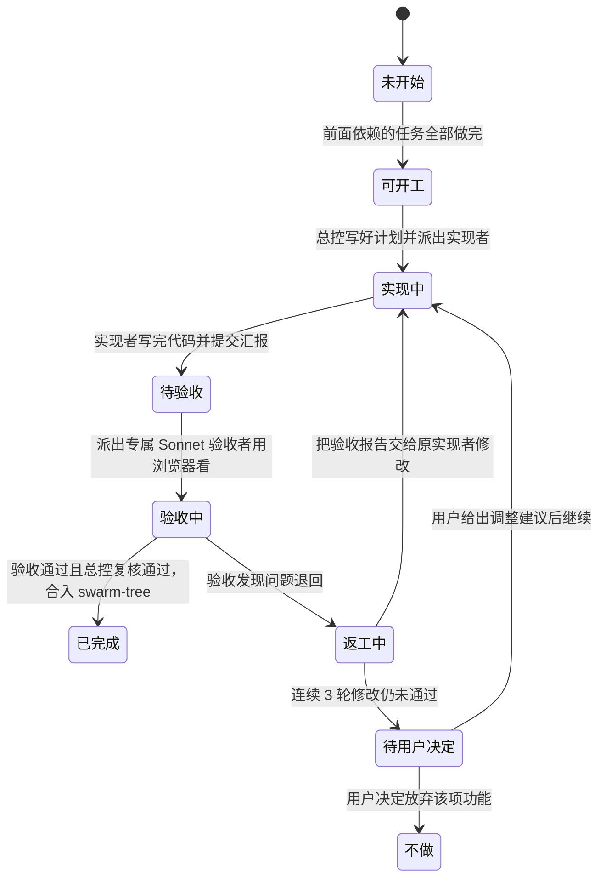

# 蜂群子代理协作工作规程

> 这份文档规定主会话（总指挥）如何派出多个 AI 子代理协同写代码、验收和推进任务。
> 具体的任务清单和先后依赖关系，请看 `ROADMAP.md`。
> 下面提到的命令都在 `scripts/swarm/` 里，详细用法见 `scripts/swarm/README.md`。
> **新会话接手总控时，先读 `HANDOFF.md`**。里面写了当前进度、还没定的事和汇报风格。每次交接时都要更新它。

## 总控派活速查

| 时机 | 命令 |
| --- | --- |
| 派活前看谁该开工 | `node scripts/swarm/status.mjs ready` |
| 建工作区 | `node scripts/swarm/worktree.mjs new <节点ID> <简短名>` |
| 写计划 | 复制 `templates/plan.md`、`templates/verify.md` 到 `nodes/<节点ID>/` 再填 |
| 派子代理 | 提示词照 `templates/dispatch.md` 填 |
| 改状态 | `node scripts/swarm/status.mjs set <节点ID> <状态> [--round N] [--impl 名字] [--verify 名字] [--result 文本] [--pr 文本]` |
| 看现状 | `node scripts/swarm/status.mjs show`、`node scripts/swarm/worktree.mjs ls` |
| 复核加合入 | `node scripts/swarm/worktree.mjs merge <节点ID>` |

一个节点从开工到合入，总控依次执行：

1. `status.mjs ready`：看哪些节点该解锁、谁卡住的下游最多。
2. `worktree.mjs new C1 inputs`：记下打印出来的槽位和端口，写进计划。
3. 照模板写 `plan.md` 和 `verify.md`。
4. `status.mjs set C1 实现中 --round 1 --impl C1-impl`，派出实现者。
5. 实现者回报后：`status.mjs set C1 待验收`，再 `status.mjs set C1 验收中 --verify C1-verify`，派出验收者。
6. 验收不通过：`status.mjs set C1 返工中 --result "第 1 轮不通过 15/18"`，再 `status.mjs set C1 实现中 --round 2`。
返工轮次的文件约定：

- 第 N 轮（N ≥ 2）的返工计划写成 `nodes/<ID>/plan-r<N>.md`。里面只写这一轮要改什么，并注明依据是 `verify-<N-1>.md` 的哪些项。`plan.md` 不动。
- 新的检查项追加到 `verify.md` 末尾，编号接着往下排，开头标上「（第 N 轮）」。已有的编号不改。
- 实现者的回报写成 `impl-<N>.md`，验收报告写成 `verify-<N>.md`，N 是轮次。
- 连续 3 轮都不通过，就停下来问用户，不要自己派第 4 轮。

7. 验收通过：读完 `verify-<N>.md`，按「总控验收后的终审复核」的第 2 步，用 `merge --keep` 复核，再开节点 PR 合进 `swarm-tree`。合入后执行 `status.mjs set C1 已完成 --result "通过 18/18" --pr #<PR号>`，下游会自动变成「可开工」。

## 节点生命周期状态图

每个任务节点都会经历下面这段流转过程。像工厂流水线一样，做完一步才能进下一步：



---

## 名词小词典

| 词汇 | 大白话解释 |
| --- | --- |
| 总控 (主会话) | 相当于大工头。负责分配任务、看进度表、检查最终质量，但不亲自写代码。 |
| 子代理 (sub-agent) | 相当于具体干活的工人。被总控派出去独立完成某一项专门的事情。 |
| 实现者 | 专门负责按照图纸动手写代码、修功能的子代理。 |
| 验收者 | 专门负责给写好的代码找茬、挑毛病的质检员子代理。模型固定使用 `sub2tok/claude-sonnet-5-5`。 |
| worktree (独立工作区) | 在电脑里单独开辟的一块工作文件夹。每个工人有一间独立房间，互不打扰。 |
| 互斥锁 (lock) | 类似于卫生间门锁。一次只能进一个人，先到先用，用完开门，后来的排队。 |
| rebase | 代码重新排队。把自己的新改动挪到别人最新合入的代码后面，避免打架。 |
| 无头浏览器 | 没有显示器界面的纯后台浏览器。AI 用它在后台打开网页并给网页截图。 |

---

## 三个角色的分工职责

### 每个角色用哪个模型

为了节省费用，三个角色固定使用不同的模型：

| 角色 | 模型 | 说明 |
| --- | --- | --- |
| 总控：写 `plan.md`、`verify.md`，复核、合入 | `sub2tok/claude-opus-5-5` | 计划写得好不好，决定了后面所有工作的质量，所以用最强的模型 |
| 实现者 | `sub2tok/claude-sonnet-5-5` | 派活时必须显式写上 `model`，不能用默认值。试过 deepseek-flash，返工轮次太多、收敛不了，已经停用 |
| 验收者 | `sub2tok/claude-sonnet-5-5` | 派活时必须显式写上 `model` |

计划仍然要写得具体：改哪些文件、按什么顺序改、每一步怎么自测，都要写清楚。实现者能照着做，不需要自己猜。验收标准保持不变。


每一个任务节点都必须配置两个**完全不同**的子代理：一个负责实现，另一个负责验收。

| 角色 | 由谁担任 | 负责做什么 | 绝对不能做什么 |
| --- | --- | --- | --- |
| **总控** | 主会话（你正在对话的我） | ① 编写执行计划与验收计划（`templates/`）<br/>② 创建独立工作区（`worktree.mjs new`）<br/>③ 派发子代理<br/>④ 更新地图进度（`status.mjs set`）<br/>⑤ 合入最终代码（`worktree.mjs merge`） | 绝对不亲自直接编写节点的业务代码。不手改 ROADMAP 里的节点状态，一律用 `status.mjs set`。 |
| **实现者** | 独立的子代理<br/>（固定使用模型：<br/>`sub2tok/claude-sonnet-5-5`） | ① 按照 `plan.md` 的计划动手修改代码<br/>② 跑通本地自动化测试<br/>③ 提交代码到节点专属分支并写汇报 | 绝对不擅自修改 `ROADMAP.md` 的任务状态，绝对不自己宣布做完了。 |
| **验收者** | 独立的质检子代理<br/>（固定使用模型：<br/>`sub2tok/claude-sonnet-5-5`） | ① 严格按照 `verify.md` 逐条核对<br/>② 必须在后台打开真实浏览器亲眼查看界面<br/>③ 给出客观明确的验收通过或不通过结论 | 绝对不修改任何源码，绝对不替实现者动手修 Bug。保持工作区完全干净。 |

---

## 节点规范文件与目录结构

每个任务节点都在仓库中拥有自己的专属文件夹：

```
.agents-work/upstream-sync-0.7.1/nodes/<节点ID>/
├── plan.md          执行计划书：总控派活前写好
├── verify.md        验收计划书：总控派活前写好，本轮开发期间不许修改
├── impl-<N>.md      第 N 轮实现者汇报：做了什么、自测结果、遗留问题
└── verify-<N>.md    第 N 轮验收者报告：逐条检查结论、证据、截图路径
```

> **注意**：截图等证明材料统一放在 `.agents-work/upstream-sync-0.7.1/nodes/<节点ID>/evidence/<N>/`。这个目录体积较大，配置了忽略规则，不需要提交到 Git。

### 两份核心计划书的编写要求

模板在 `.agents-work/upstream-sync-0.7.1/templates/`：`plan.md`、`verify.md` 是两份计划书，`impl-report.md`、`verify-report.md` 是两份回报的格式。复制到节点目录后再填，下表是每份必须包含的内容。

| 文件名 | 必须包含的关键内容 | 编写原则 |
| --- | --- | --- |
| `plan.md`<br/>（执行计划） | ① **最终目标**：用一两句大白话讲清做完后界面有什么改变。<br/>② **任务范围**：写清哪些文件要改，哪些文件坚决不碰。<br/>③ **上游依据**：列出对应的上游差异台账条目与上游源代码路径。<br/>④ **开发步骤**：按顺序写清楚先改哪里、后改哪里、改成什么样。<br/>⑤ **自测要求**：写清楚开发完后需要跑哪些测试命令、看哪些页面。<br/>⑥ **回报格式**：明确规定 `impl-<N>.md` 里必须填写的总结结构。 | 由总控依据全局地图和上游代码编写，让实现者拿到就能直接照着做。 |
| `verify.md`<br/>（验收计划） | ① **逐条检查项**：每条必须能明确判定「合格」或「不合格」，不留模糊空间。<br/>② **检查操作法**：跑什么命令、开哪个网页链接、点哪个按钮、看什么效果。<br/>③ **浏览器核验**：涉及界面的节点，必须在 桌面/390px手机窄屏 × 浅色/深色 共 4 种组合下对比上游同款示例。<br/>④ **反向挑刺**：故意检查边界情况（如键盘操作、无障碍读屏、服务端渲染、超长文字、空数据）。<br/>⑤ **一票否决**：只要有任何一条不合格，总体结论直接判为「不通过」。 | 验收计划完全独立编写，从产品终态出发，绝不照抄实现者的开发总结。 |

---

## 硬件资源保护与并发上限

当前开发设备为：**Apple M2 Pro 芯片，10 核 CPU，16GB 内存**。为了防止电脑卡死，严格执行资源限制：

| 资源类别 | 最大允许数量 | 设限原因 |
| --- | --- | --- |
| **同时活跃子代理总数** | **3 个** | 每个子代理在工作时都会运行测试、打包代码和启动网页服务。 |
| **同时打开的浏览器会话** | **2 个** | 一个无头后台浏览器在多尺寸截图时大约消耗 0.5 到 1GB 内存。 |
| **同时运行的文档站服务** | **2 个** | VitePress 文档站开发服务每个大约消耗 0.5 到 1GB 内存。 |
| **同时存在的工作区** | **4 个** | 控制磁盘占用，避免多人同时修改全局生成文件造成代码冲突积压。 |
| **单个工作区测试并发数** | **2 个进程** | 跑单测时统一加上参数限制：`pnpm vitest run --maxWorkers=2`。 |

### 内存防爆与排队机制

1. **内存压力检测**：总控每次派出新的子代理前，先在终端检查系统内存。如果可用内存低于 **25%**，暂停派发新任务，等待正在跑的子代理结束后再继续。
2. **浏览器互斥锁**：排队专用锁目录放在 git 的公共目录里：`$(git rev-parse --git-common-dir)/swarm-locks/browser-1` 和 `browser-2`。所有工作区看到的是同一份锁。
   - 视觉对照 `pnpm visual <组件> --out /tmp/...` 会自动拿锁、排队、还锁。
   - 其它要开浏览器的命令（自己写的 Playwright 脚本等），一律套上 `node scripts/swarm/browser-lock.mjs run --purpose <说明> -- <命令>`。命令结束、出错、按 Ctrl+C 都会自动还锁。
   - 拿不到锁就排队等待，严禁私自多开浏览器。`node scripts/swarm/browser-lock.mjs status` 能看到谁占着。

---

## 独立工作区与端口分配表

为了让每个子代理的代码互不干扰，每个任务节点使用 Git 独立工作区（worktree）。

| 项目 | 约定与规范 |
| --- | --- |
| **创建工作区命令** | `node scripts/swarm/worktree.mjs new <节点ID> <简短名>`。它从 `swarm-tree` 切出 `sync/<节点ID小写>-<简短名>`，建到 `../astryx-vue-wt/<节点ID>`，分配槽位，装好依赖。`worktree.mjs ls` 列出所有工作区和槽位。 |
| **共用工作区原则** | 同一个任务节点的实现者和验收者使用**同一个工作区**。 |
| **验收者只读铁律** | 验收者只看不改。验收工作结束时，终端运行 `git status` 必须没有任何改动文件，否则本次验收成绩直接作废。 |
| **槽位与端口分配** | 每个活跃的工作区分配一个专属槽位编号（**1 到 4 号**），由 `worktree.mjs new` 自动分配，登记在 `$(git rev-parse --git-common-dir)/swarm-slots/`。<br/>该工作区启动文档站时的专属端口为：**`5170 + 槽位号`**（例如 1 号槽位为 5171，2 号为 5172）。`pnpm visual` 会自动用本工作区的端口。用完后必须及时关闭该服务。<br/>手工建的旧工作区用 `worktree.mjs adopt <节点ID> <槽位>` 补登记。 |
| **完工清理** | `worktree.mjs merge` 合入成功后会自动删除工作区、分支和槽位登记。只删不合用 `worktree.mjs rm <节点ID>`，分支没合入时要加 `--force`。 |

---

## 派活顺序与合并规则

总控在派发任务时，遵循以下三个规则：

1. **谁卡住的人多就先派谁**：在当前所有「可开工」的节点里，看谁下游依赖的节点最多，优先派谁开工。
2. **验收比新活更着急**：只要有节点处于「待验收」状态，优先派出 Sonnet 验收者去检查，然后再去开新的开发任务。
3. **公共生成文件排队合入**：运行 `pnpm sync` 产生的公共导出文件，同一时间只允许一个节点往主分支合并。`worktree.mjs merge` 用合并锁保证这一点，并且先 rebase：冲突只落在生成文件上时，它自动处理并重新跑 `pnpm sync`：整份生成的文件取节点版本；`packages/core/package.json` 做 JSON 合并，exports 交给 sync 重新生成，其它字段两边的改动都保留。两边把同一个非生成字段改得不一样，或者还有别的冲突，就停下，报出冲突文件，分支回到原样。绝不手动解决生成文件冲突。只想同步最新代码、不合入时用 `worktree.mjs rebase <节点ID>`。

派活前先跑 `node scripts/swarm/status.mjs ready`。它列出两张清单，都按下游节点数从多到少排：一张是依赖已经全部完成、还标着「未开始」的节点，用 `status.mjs set <节点> 可开工` 解锁；另一张是已经「可开工」、等着派发的节点，排在前面的先派。

---

## 对齐上游的标准：看效果，不看代码

我们要和上游一致的是两样东西：**用户看到的样子**，和**用户操作时的手感**。代码不需要一行对一行地照着 React 版本翻译。

| 必须一致 | 不需要一致 |
| --- | --- |
| 截图对比：布局、间距、颜色、字号、深浅色、窄屏 | 文件怎么拆、函数叫什么名字 |
| 交互：键盘、鼠标、触屏、焦点怎么移动、动画的节奏 | React 专有的写法：render prop、ref 转发、`useEffect` 的写法 |
| 读屏软件读出来的内容：role、名称、状态 | StyleX 这类上游专用的工具链 |
| 公开 API 能做到的事情：同样的需求，用户都能做到 | API 的具体形状：Vue 用 props、事件、插槽、`v-model` 来表达 |

对各个角色的要求：

- **总控写 `plan.md`**：先写清楚上游这条改动让用户看到或者感受到了什么，再给出实现建议。如果有更适合 Vue 的做法，要在计划里写出来。比如上游用 render prop，我们用作用域插槽；上游用 StyleX 的 data token，我们用 CSS 变量。
- **实现者**：可以提出比计划更适合 Vue 的方案，只要最终效果一致就行。写进回报时要说明：上游怎么做、我们怎么做、为什么效果相同。
- **台账**：每条上游提交只是参考。如果我们现在的做法已经能达到同样的效果，可以标为「不适用」，同时写明理由和证据。
- **`verify.md` 和验收者**：按效果来判断，不按代码长得像不像来判断。检查项要写成「打开哪个页面、做什么操作、应该看到什么」，主要证据是截图对比和交互测试。只要效果一致，代码结构和上游不同不算问题。发给用户看的那组图必须是文档站整页，不能用夹具或 overview 代替。左右对照还必须对上同一处 Demo，见「发给用户的验收对照图」。

### 不用 `!important`

组件库和主题里，一处 `!important` 都不能有。优先级的问题，用 CSS 层（`@layer`）的先后顺序和选择器来解决。

原因：`!important` 会让使用者没办法在自己的样式表里覆盖组件和主题。组件库最不该拿走的，就是这个能力。上游的主题系统也一处都没用。

`scripts/check-no-important.mjs` 已经接进 `pnpm check`，出现 `!important` 时检查会直接失败。测试文件不受这条限制，因为测试可能要断言「输出里没有 `!important`」。如果实现时觉得非用不可，先停下来，在回报里写清楚原因，由总控决定。

### 图标用我们自己的方案

图标是一个明确「不照搬上游」的地方。上游用的是 React 组件形式的图标注册表，我们有自己的一套，详细说明在 `apps/docs/docs/zh/guide/icons.md`：

1. `Icon` 组件按 Iconify 名字画图标，比如 `<Icon name="carbon:settings" />`，不需要每个图标单独 import。
2. `astryxIcons()` 这个 Vite 插件会扫描模板里静态写出来的图标名，只把用到的那几个从 `@iconify-json/*` 打进包。core 本身不内置任何图标库，也不依赖 UnoCSS。
3. 运行时才知道名字的图标，用 `addCollection` 或 `addIcon` 注册。
4. 组件内部只用语义名，比如 `search`、`close`、`upload`，对照表在 `packages/core/src/Icon/semantic.ts`。默认对应 Lucide。用户没有注册 Lucide 时，退回内置图形（`glyphs.ts`），不会显示成空白。主题用 `defineTheme({ icons })` 整套替换。只属于某个组件的图标，用带命名空间的键，比如 `numberInput:stepperDown`。
5. 组件的 `icon`、`iconClass` 属性也可以直接传 CSS 类名。

上游哪条改动涉及图标（比如新增了一个需要的图标、组件改用某个语义图标），都按这套方案落地：在语义表里加名字和默认的 Lucide 图标，需要的话在内置图形里补一个兜底图形。**不要引入另一套图标注册机制，也不要把上游的图标 React 组件翻译过来。** 写计划和验收时，都要检查这一点。

## 发给用户的验收对照图

C9 Markdown 第 2 轮 checklist 28/28 通过之后，总控把对照图发给用户。用户马上问：这截的是不是文档页，怎么只有这么一点内容。那批图其实是夹具页、Vite preview 单组件页，或者 `pnpm visual` 的 overview 卡片首屏。夹具没有侧栏和文档壳，overview 也只是组件总览卡片，都不是带侧栏、标题、多组 DemoExample（Cited、Plugins、Compact、Table、Rich 这类）的文档整页。checklist 全过，不代表图能拿去给用户看。

发给用户的图，必须让人一眼看出这是文档站，而且内容要够。硬规则如下：

- **对照图就是文档站组件页整页。** 打开 VitePress 文档站里这个组件自己的页面，把整页截下来。中文页地址是 `/components/<slug>`（源文件在 `apps/docs/docs/zh/components/<slug>/`，根语言是中文，地址里没有 `/zh/`）。需要对照英文文档时，再截 `/en/components/<slug>`。本地文档站端口是 `5170 + 槽位号`，例如 `http://127.0.0.1:5171/components/markdown`。图里必须能看到文档壳。桌面要看见侧栏，不能只剩顶栏。390 宽时侧栏收起，要看见顶栏上的「菜单」。不能只截中间那一块组件本体。
- **下面这些不能当成给用户看的主证据：** 节点夹具页、Vite preview 单页、`pnpm visual` 的 overview 和卡片拼图、只有一两行示例的首屏。
- **`pnpm visual` 和夹具仍然可以用来内部对像素。** 验收者自己核对间距、颜色时可以用。总控发给用户的至少 4 到 5 张，必须是文档站整页：桌面和 390 宽、浅色和深色都要有。能对上同一处 Demo 时才做左右对照，左边上游、右边我们。对不上就不要拼。内容区要滚到有实质 Demo 的段落，不能只剩标题和一片空白。
- **左右对照必须是同一处，禁止把无关区块拼在一起。** 2026-10-21 用户批评上一轮 C3：左边是文档站的「次要样式 / 选项操作」，右边却是原版 Guidance 的 Do/Don't 或 Validation States。两边不是同一位置，这张图没有用。硬规则如下：
  - 左右必须是同一个组件、同一个 Demo 区块标题、同一滚动位置、同一交互状态。菜单、对话框、下拉是开着的，两边都开着；是关着的，两边都关着。
  - 原版只截 Overview 里的 Demo。禁止截 Guidance、Practices，以及 Do/Don't、Validation States 这类说明区。
  - 本地必须是 VitePress 文档站整页。桌面图里侧栏要看得见。390 宽时侧栏收起，顶栏上的「菜单」要看得见，不能裁成没有文档壳的一块。
  - 没有对得上的 Demo，就不要硬拼。报告写明「无对位」，改发这一侧的文档站整页。
  - 无关区块拼出来的图不能叫对照图，也不能发给用户。对不上就整张作废。
- **截图不入库。** 证明材料放在 `.agents-work/upstream-sync-0.7.1/nodes/<节点ID>/evidence/<N>/`，这个目录已经写进 `.gitignore`。不要 `git add -f` 把 PNG 强行加进仓库。截图只发给用户看。

## 验证操作要短小、可重复

每一次验证操作都要短小精干、可以重复跑。不要写一个耗时很长、一直阻塞的大操作：等待时间一长，人和 agent 都容易迷失，卡住了也看不出卡在哪。

- **一次只验证一件事。** 浏览器探测脚本一个脚本只测一项，比如「禁用按钮的指针」。不要把十几项塞进同一个脚本：中间某一步卡住，前面的结果就全丢了。
- **每条命令都要有时间上限。**
  - 浏览器命令通过 `browser-lock.mjs run --max-run <秒>` 跑。默认 180 秒，到时间自动结束，退出码是 124。
  - 其他可能卡住的命令，前面加 `timeout <秒>`。
  - 单条命令超过 3 分钟，就说明拆得不够细。全量 vitest 和 `worktree.mjs merge` 本来就慢，是例外。
- **超时就是信号，不要原样重跑。** 先弄清卡在哪一步，再把那一步单独拿出来跑。
  - 换一种更简单的观察方法。
  - 如果这个环境确实测不了（比如 WebKit 模拟 iOS），就改成读代码确认，并在报告里写明「只能读代码确认」。
- **脚本和结果都落盘。** 探测脚本放在 `/tmp/verify-<ID>/`，结果写进文件，比如 `item7.json`，然后在报告里引用。这样别人可以重跑同一个脚本，复现同一个结果。
- **长时间运行的服务放后台，用完就关。** 比如文档站。开起来时记下 PID 和端口，测完马上关掉。
- **不要建只为对比用的大型 BASE 工作区。** 能用 `git show BASE:<文件>`、`git diff BASE` 或已有截图回答的问题，就不要重新装依赖、起服务。

## 跑检查时的环境

主会话所在的终端默认带着 `NODE_ENV=production`。Vue 在生产模式下会删掉模板里的注释，在开发模式下会保留。所以同一份测试，在两种模式下可能一个通过、一个失败。CI 里没有这个变量。

测试本身已经不受这个变量影响：`vitest.config.ts` 先把 `NODE_ENV` 设成 `test`，再加载 Vue 插件，所以运行时和模板编译都固定在开发模式，和 CI 一样。`tests/test-env.test.ts` 守着这一点。构建、文档站等其它命令仍然会受影响。

规定：
- 所有子代理和总控跑测试、跑 `pnpm check` 时，命令前面都加上 `env -u NODE_ENV`，让环境和 CI 一样。`worktree.mjs merge` 跑检查时会自动去掉它。
- 验收计划里，测试相关的检查项要求跑两遍：一遍不设 `NODE_ENV`，一遍设成 `NODE_ENV=production`。两遍都要通过，用例数要相同。

## 总控验收后的终审复核

当 Sonnet 验收者给出「通过」结论后，总控在把节点标记为「已完成」前，必须亲手完成以下 3 件事：

1. **查验真凭实据**：完整通读 `verify-<N>.md`，确认每一条检查项都附带了明确的命令输出、截图或证据，没有任何一项目测敷衍或留空。涉及界面的节点，发给用户之前先核对对照图：必须是文档站整页，按「发给用户的验收对照图」来。左右对照还要对上同一组件、同一 Demo 区块标题、同一滚动位置、同一交互状态。原版只能是 Overview 里的 Demo，不能是 Guidance 或 Practices。对不上的拼图不能发出去，改发单侧整页，并在报告里写「无对位」。夹具页、Vite preview 单页、`pnpm visual` 的 overview 不能发出去。
2. **复核并合入（在 GitHub 上留痕）**：
   1. 在主工作区运行 `node scripts/swarm/worktree.mjs merge <节点ID> --keep`。它会先 rebase 到最新的 `swarm-tree`，然后在节点工作区里跑完整检查（check:packages、lint、typecheck、vitest、build、lint:pkg，不带 `NODE_ENV`）。全部通过后，在本地把节点分支 fast-forward 合进 `swarm-tree`，并保留工作区。任何一步失败都不会合入，按报错处理后重跑。
   2. 推送节点分支：`git push -u origin sync/<节点>-<简短名>`。
   3. 开 PR，方向是 `sync/<节点>-<简短名>` → `swarm-tree`：
      - 标题写 `<节点ID> <节点名称>`。
      - 正文照 `pr` skill 的模板写，要说明三件事：这个节点改了什么、验收结论（附 `nodes/<ID>/verify-<N>.md` 的路径），以及复核时 `merge` 的检查结果。
   4. **节点 PR 的 CI 必须全绿，才能合进 `swarm-tree`。** `Check and dry-run` 和 `Test under production shell` 都绿了再做下一步。节点验收只跑相关测试，不跑全量套件，也不跑 `check:packages`，服务端渲染和 catalog 过期只有 CI 能拦住。若这两项是红的，而且红在别的节点留下的问题上，PR 正文必须点名这个问题，并写明已经有人认领，否则不能合。
   5. **不等人工评审**。上一步通过之后，推送本地的 `swarm-tree`（`git push origin swarm-tree`）。它已经包含节点分支的全部提交，GitHub 会自动把这个 PR 标成 Merged，PR 页面上保留完整的提交和正文。如果 PR 没有自动变成 Merged，再执行 `gh pr merge <PR号> --rebase`。
   6. 运行 `worktree.mjs rm <节点ID>`，清掉工作区和本地分支。
   7. 节点合向 `swarm-tree` 的 PR **不部署文档预览**，`docs.yml` 只在合向 `main` 或 `dev` 的 PR 上部署。`swarm-tree` 一更新，总 PR #128（`swarm-tree` → `dev`）会自动重新部署，用户在那个预览站上验收。
3. **更新看板**：`node scripts/swarm/status.mjs set <节点ID> 已完成 --result "通过 X/Y" --pr #<PR号>`。它同时改树状图和总表，并把依赖已经全部完成的下游节点改成「可开工」。改完跑一次 `status.mjs check` 确认一致。
