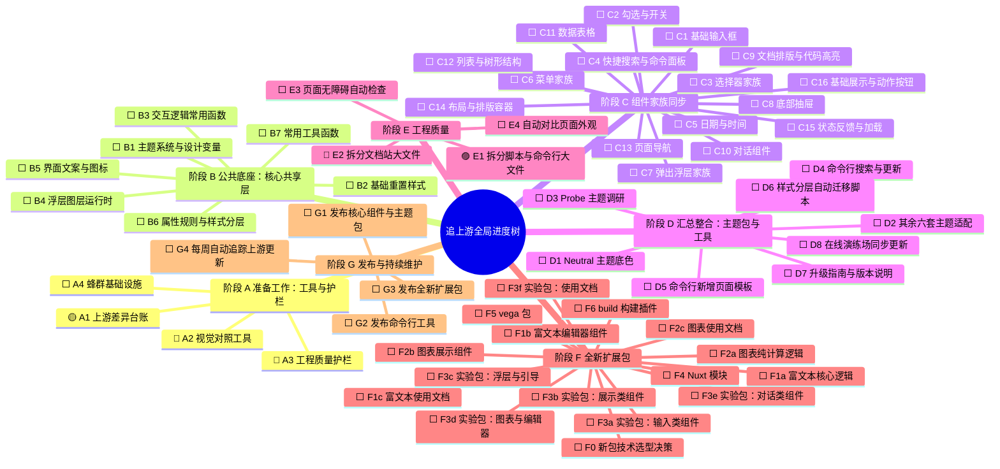
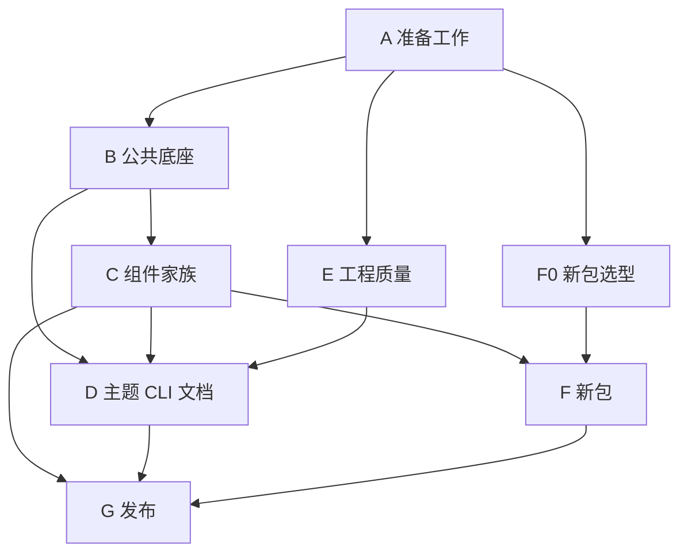
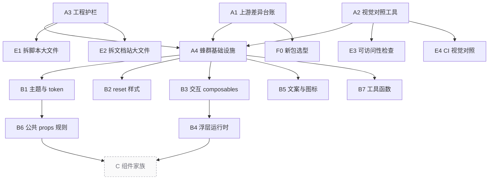
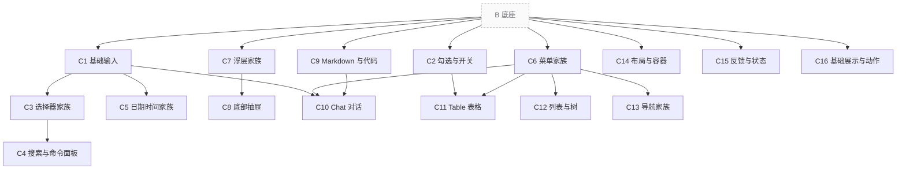
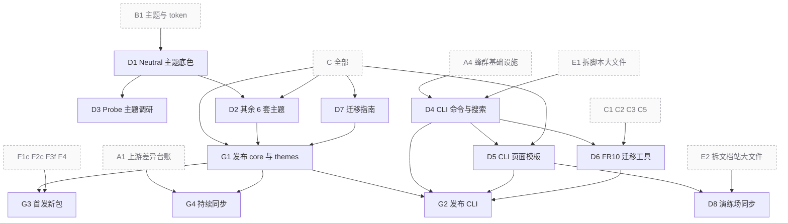
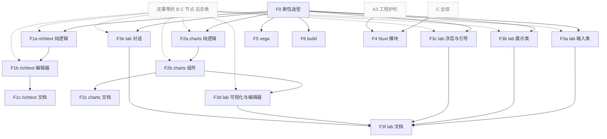

# 追上游任务地图与实时进度

> 这份文档是唯一的进度看板。所有的任务状态都在这里更新。
> 怎么分工派活、怎么检查验收，请看 `SWARM.md`。

## 全局进度树状图

### 状态图例

- ⬜ 未开始：前面还有没做完的任务，暂时不能动手。
- 🔵 可开工：前置任务全做完了，等待总控派发任务。
- 🟡 实现中：负责写代码的子代理正在开发。
- 🟣 待验收：代码写完了，等待验收者检查。
- 🔷 验收中：负责检查的子代理正在用浏览器验证。
- 🔴 返工中：检查没通过，退回重新修改。
- 🟠 待用户决定：连续 3 次没通过，暂停等待用户拿主意。
- ✅ 已完成：检查通过，总控复核过，代码已合入 `swarm-tree` 分支。
- ➖ 不做：经过评估决定不需要移植。

---

## 名词小词典

| 词汇 | 大白话解释 |
| --- | --- |
| 上游 (upstream) | 源头项目。这里指 Meta 公司用 React 写的原版设计系统代码。 |
| 下游 | 跟随源头改造的项目。这里指我们正在做的 Vue 3 移植版本。 |
| token (设计变量) | 给颜色、间距起的名字。比如主色调、中等间距。改一处名字，全套界面跟着变。 |
| rem | 相对长度单位。尺寸会跟着网页根字号等比例缩放。 |
| composable | Vue 组合式函数。把常用的交互逻辑抽出来做成积木，比如 `useXxx`。 |
| SSR (服务端渲染) | 网页先在后台服务器拼好骨架，再发给浏览器。这样打开网页更快。 |
| FR10 | 上游组件规范里的第 10 条要求。它规定输入类组件的样式要分两层设置：外框叫 container，里面的控件叫 control。 |
| theme target (换肤挂载点) | 组件上预留的挂钩。方便精确定位并单独替换某个部位的样式。 |
| Layer (图层运行时) | 页面里漂浮在最上层的图层管理器。专门管弹窗、下拉菜单和气泡提示。 |
| codemod | 自动改代码的小工具。能帮开发者自动把老代码升级成新写法。 |
| worktree (git 工作区) | 同一个代码仓库可以在不同文件夹同时切不同分支干活，互不打扰。 |
| changeset | 版本发布记录工具。自动管理版本号和更新日志的小帮手。 |
| 蜂群 (swarm) | 多个 AI 协同工作的模式。主会话当总指挥，派多个 AI 子代理去干活。 |

---

## 为什么做这件事与背景数据

astryx-vue 是把 Meta 公司的 React 设计系统改写成 Vue 3 的版本。

- 本仓库当前对齐的上游版本：`0.4.1`（Git 提交号 `96f9917f`）。
- 本轮目标：完全跟进到上游正式标签 `v0.7.1`。
- 上游 main 分支之后的新提交，留给 G4 节点的每周自动化同步机制处理。
- 两个版本之间上游一共有 1693 个提交：
  - 805 个改了核心组件库 `core`。
  - 418 个改了命令行工具 `cli`。
  - 71 个改了主题包 `themes`。
- 上游还有几个我们尚未移植的新扩展包：
  - `richtext`：基于 Lexical 的富文本编辑器。
  - `charts`：图表展示库。
  - `lab`：19 个实验性组件（上游只发 canary 测试版）。
  - `vega`：数据可视化包（上游只发 canary 测试版）。
  - `build`：StyleX 专用的样式构建插件。

核心库 `core` 中改动最多的部分（按上游提交数统计）：

| 模块或组件 | 提交数 | 模块或组件 | 提交数 |
| --- | --- | --- | --- |
| Markdown | 299 | DropdownMenu | 203 |
| Chat | 183 | theme | 160 |
| Table | 154 | BottomSheet | 139 |
| Selector | 133 | hooks | 131 |
| DateInput | 98 | MultiSelector | 91 |

---

## 任务前后依赖关系图

箭头的意思是「前面的做完，后面的才能开工」。
节点太多，画在一张图里会缠成一团，所以先看阶段总览，再分四张小图看细节。
灰色虚线框是别的图里的节点，只是在这里露个面。每个节点完整的依赖，以后面的「当前状态总表」为准。

### 总览：阶段之间的先后

### 图一：准备工作与公共底座

### 图二：组件家族

「B 底座」代表 B1 到 B7，每个 C 节点具体要哪几个，看状态总表。

### 图三：主题、CLI、文档与发布

「C 全部」表示 C1 到 C16 都做完。

### 图四：新包

---

## 协作规则与完成标准

### 任务最小单元

整个地图分三层：**阶段 → 任务树节点 → 检查项**。
**任务树节点**是最小管理单位。每个节点由两个不同的子代理配合完成：

1. **实现者**（默认模型）：按照总控写好的 `plan.md` 动手改代码。
2. **验收者**（固定使用 `sub2tok/claude-sonnet-5-5` 模型）：按照总控写好的 `verify.md` 逐项检查，必须打开浏览器亲眼看。

### 推进原则

1. **没有验收者点头不算做完**：必须拿到 Sonnet 验收者的「通过」结论。依赖它的下游节点才能变成「可开工」。
2. **返工不卡别人**：某个节点没通过，只在它自己的分支上反复修改，不影响其他平行的任务。
3. **达标才能交卷**：通用完成标准全满足、`verify.md` 每项都通过、总控亲自复核完毕，才能改成「已完成」。
4. **范围不对先汇报**：做到一半发现改动范围不对，立刻向总控汇报，由总控改地图。子代理不要擅自扩大或缩小范围。
5. **机器资源有上限**：同一时间最多 3 个活跃子代理、最多 2 个浏览器窗口，具体看 `SWARM.md`。

### 通用完成标准（每个节点都必须做到）

- 从 `swarm-tree` 分支拉新分支，命名为 `sync/<节点ID小写>-<简短名>`。验收通过后由总控合回 `swarm-tree`。
- 终端运行 `pnpm check` 必须全绿通过，不能有任何报错。
- 本节点修改的源码文件，单文件不能超过 500 行。如果改到了原来就超标的文件，顺手拆成小文件。
- 不要手动修改自动生成的文件。改完后运行 `pnpm sync` 重新生成。
- 只要改到了组件外观或交互，PR 里必须附上 4 种外观对比截图：上游与我们对比，包含桌面端与 390px 手机窄屏、浅色模式与深色模式。
- 凡是用到了 A1 差异台账的节点，台账里属于本节点的每一项，都要标为「已采纳」或注明「不适用及理由」，不能留空。

---

## 当前状态总表

| 节点 | 名称 | 依赖 | 状态 | 轮次 | 实现者 | 验收者 | 最近验收结论 | PR |
| --- | --- | --- | --- | --- | --- | --- | --- | --- |
| A1 | 上游差异台账 | — | 🟡 实现中 | 1 | 已派出 | | | |
| A2 | 视觉对照工具 | — | 🔷 验收中 | 1 | A2-impl | A2-verify | 通过 24/24；总控复核等 A3 修好后再跑 | |
| A3 | 工程护栏 | — | 🔴 返工中 | 2 | A3-impl | A3-verify | 第 1 轮通过，合入后发现：不设 NODE_ENV 时 14 条测试失败 | 163f333 |
| A4 | 蜂群基础设施 | A1 A2 A3 | ⬜ 未开始 | 0 | | | | |
| B1 | 主题系统与 token | A4 | ⬜ 未开始 | 0 | | | | |
| B2 | reset 与基础样式 | A4 | ⬜ 未开始 | 0 | | | | |
| B3 | 交互底座 composables | A4 | ⬜ 未开始 | 0 | | | | |
| B4 | 浮层运行时 Layer | B3 | ⬜ 未开始 | 0 | | | | |
| B5 | 文案与图标 | A4 | ⬜ 未开始 | 0 | | | | |
| B6 | 公共 props 规则 | B1 | ⬜ 未开始 | 0 | | | | |
| B7 | 工具函数 utils | A4 | ⬜ 未开始 | 0 | | | | |
| C1 | 基础输入 | B1 B2 B3 B5 B6 | ⬜ 未开始 | 0 | | | | |
| C2 | 勾选与开关 | B3 B6 | ⬜ 未开始 | 0 | | | | |
| C3 | 选择器家族 | C1 B4 | ⬜ 未开始 | 0 | | | | |
| C4 | PowerSearch / CommandPalette | C3 | ⬜ 未开始 | 0 | | | | |
| C5 | 日期时间家族 | C1 B4 B7 | ⬜ 未开始 | 0 | | | | |
| C6 | 菜单家族 | B3 B4 B6 | ⬜ 未开始 | 0 | | | | |
| C7 | 浮层家族 | B4 B6 | ⬜ 未开始 | 0 | | | | |
| C8 | BottomSheet | C7 | ⬜ 未开始 | 0 | | | | |
| C9 | Markdown 与代码 | B1 B2 | ⬜ 未开始 | 0 | | | | |
| C10 | Chat | C9 C6 C1 | ⬜ 未开始 | 0 | | | | |
| C11 | Table | C2 C6 | ⬜ 未开始 | 0 | | | | |
| C12 | 列表与树 | B3 C6 | ⬜ 未开始 | 0 | | | | |
| C13 | 导航家族 | B4 C6 | ⬜ 未开始 | 0 | | | | |
| C14 | 布局与容器 | B1 B3 B6 | ⬜ 未开始 | 0 | | | | |
| C15 | 反馈与状态 | B1 B6 | ⬜ 未开始 | 0 | | | | |
| C16 | 基础展示与动作 | B1 B3 B5 B6 | ⬜ 未开始 | 0 | | | | |
| D1 | Neutral 主题底色 | B1 | ⬜ 未开始 | 0 | | | | |
| D2 | 其余 6 套主题适配 | D1 C全部 | ⬜ 未开始 | 0 | | | | |
| D3 | Probe 主题调研 | D1 | ⬜ 未开始 | 0 | | | | |
| D4 | CLI 命令与搜索 | A4 E1 | ⬜ 未开始 | 0 | | | | |
| D5 | CLI 页面模板 | D4 C全部 | ⬜ 未开始 | 0 | | | | |
| D6 | FR10 迁移 codemod | D4 C1 C2 C3 C5 | ⬜ 未开始 | 0 | | | | |
| D7 | 迁移指南与版本信息 | C全部 | ⬜ 未开始 | 0 | | | | |
| D8 | 演练场同步 | D5 E2 | ⬜ 未开始 | 0 | | | | |
| E1 | 拆分脚本与 CLI 生成器大文件 | A3 | 🟣 待验收 | 1 | E1-impl | | 等 A3 返工通过后再验收 | |
| E2 | 拆分文档站大文件 | A3 | 🔵 可开工 | 0 | | | | |
| E3 | 可访问性自动检查 | A2 | ⬜ 未开始 | 0 | | | | |
| E4 | CI 接入视觉对照 | A2 | ⬜ 未开始 | 0 | | | | |
| F0 | 新包选型决策 | A1 | ⬜ 未开始 | 0 | | | | |
| F1a | richtext 纯逻辑 | F0 C9 | ⬜ 未开始 | 0 | | | | |
| F1b | richtext 编辑器 | F1a C6 C16 | ⬜ 未开始 | 0 | | | | |
| F1c | richtext 文档 | F1b | ⬜ 未开始 | 0 | | | | |
| F2a | charts 纯逻辑 | F0 B1 | ⬜ 未开始 | 0 | | | | |
| F2b | charts 组件 | F2a C7 | ⬜ 未开始 | 0 | | | | |
| F2c | charts 文档 | F2b | ⬜ 未开始 | 0 | | | | |
| F3a | lab 输入类 | F0 C3 | ⬜ 未开始 | 0 | | | | |
| F3b | lab 展示类 | F0 C15 C7 | ⬜ 未开始 | 0 | | | | |
| F3c | lab 浮层与引导 | F0 C7 C8 | ⬜ 未开始 | 0 | | | | |
| F3d | lab 可视化与编辑器 | F2b C9 | ⬜ 未开始 | 0 | | | | |
| F3e | lab 对话 | F0 C10 | ⬜ 未开始 | 0 | | | | |
| F3f | lab 文档 | F3a–F3e | ⬜ 未开始 | 0 | | | | |
| F4 | Nuxt 模块 | A3 C全部 | ⬜ 未开始 | 0 | | | | |
| F5 | vega | F0 | ⬜ 未开始 | 0 | | | | |
| F6 | build | F0 | ⬜ 未开始 | 0 | | | | |
| G1 | 发布 core + themes | C全部 D2 D7 | ⬜ 未开始 | 0 | | | | |
| G2 | 发布 CLI | G1 D4 D5 D6 | ⬜ 未开始 | 0 | | | | |
| G3 | 首发新包 | G1 F1c F2c F3f F4 | ⬜ 未开始 | 0 | | | | |
| G4 | 持续同步机制 | A1 G1 | ⬜ 未开始 | 0 | | | | |

---

## 各阶段任务细节说明

### 阶段 A 准备工作：工具与护栏

| 节点 | 要做什么 | 依赖谁 | 怎么算做完 |
| --- | --- | --- | --- |
| A1 上游差异台账 | 编写脚本 `scripts/upstream-ledger.mjs`。传入两个上游提交号，把提交分门别类整理好（分成组件、交互函数、主题、命令行工具、其它）。找出每个提交的标题、是否有破坏性改动（带感叹号 `!`）、改了哪些说明文档和测试文件。按 C 阶段的节点归类，生成 `.agents-work/upstream-sync/ledger/<节点ID>.md` 检查清单，每条前面留勾选框。 | 无 | 上游每个提交至少进入一个节点账本，或被明确标为「无关」并写明理由；一个提交改到多个节点时，在每个相关节点里都列出，并标明还涉及哪些节点；归不进任何节点的文件数为 0；脚本自带单元测试；再跑一次结果逐字节相同。 |
| A2 视觉对照工具 | 用 Playwright 编写自动化截图脚本。输入组件名，同时打开上游和我们文档站的同款示例。在 桌面/390px手机窄屏 × 浅色/深色 共 4 种组合下截图，拼成左右对比图，并算出像素差异分数。 | 无 | 在 Button、Dialog、Selector 这 3 个组件上测试跑通；输出文件目录与命名规则固定；写清使用说明文档。 |
| A3 工程护栏 | ① 编写 500 行代码检查脚本，接进 `pnpm check`。当前已经超标的文件写入白名单，白名单只许减少不许增加。② 编写 SSR 服务端渲染冒烟测试：自动用 `renderToString` 渲染所有公开组件。当前报错的组件写入「已知失败名单」，名单只许减少不许增加。③ 给 `Resizable` 组件补齐自动化测试。 | 无 | 两份名单都能自动参与检查；只要新写代码单文件超过 500 行，`pnpm check` 就会直接报错拦截。 |
| A4 蜂群基础设施 | 把 `SWARM.md` 里的约定做成现成工具：① 提供 `plan.md` 和 `verify.md` 模板。② 浏览器互斥锁：A2 已经做好 `scripts/swarm/browser-lock.mjs`，这里把它推广到所有用浏览器的地方，并写清验收者手动开浏览器时怎么套上锁。③ 工作区脚本：编写 `scripts/swarm/worktree.mjs new\|rm <节点ID>`，自动分配槽位号和端口并安装好依赖。④ 状态脚本：编写 `scripts/swarm/status.mjs`，读取总表自动计算可开工节点并核对图例颜色。⑤ 明确多人修改自动生成文件的流程：先 rebase 再执行 `pnpm sync`，不手动合并。 | A1 A2 A3 | 总控能一键为任意 C 节点创建工作区、生成计划、派出子代理；同时启动 3 个浏览器任务时，第 3 个能自动排队等待。 |

---

### 阶段 B 公共底座：核心共享层

| 节点 | 要做什么 | 依赖谁 | 怎么算做完 |
| --- | --- | --- | --- |
| B1 主题系统与 token | 同步上游 `core/src/theme` 目录。间距 token 改为随根字号变化（rem 单位）；删除老主题兼容层；加入 data token 变量；实现 theme target 换肤机制；固定触屏和手机窄屏字号阶梯；实现 MediaTheme。 | A4 | 所有主题设计变量生效；旧兼容层彻底移除；单元测试全部通过；修改的文件不超行。 |
| B2 reset 与基础样式 | 更新全局基础样式 `reset.css`。覆盖范围扩大到 `::before`、`::after`、`::placeholder` 以及搜索输入框；设定输入框最小字号；支持 `until-found` 隐藏文本搜索。 | A4 | 基础样式覆盖完整；浏览器展示无样式冲突；测试通过。 |
| B3 交互底座 composables | 同步上游 `core/src/hooks` 目录。触屏按压模型（用统一的委托控制器代替 `:active` 伪类）；menuPress、menuHover、longPress 长按；焦点陷阱与焦点归还；列表和网格按键焦点；快捷键热键；屏幕阅读器语音播报；滚动归属、滚动条占位、滚动键盘委托；容器展开；自适应呈现；媒体模式。 | A4 | 所有交互底层函数迁移完成；单元测试覆盖健全。 |
| B4 浮层运行时 Layer | 升级页面顶层图层运行时。让图层运行时统一负责处理视口内边距（对应上游 AST-059），同步更新 `LayerProvider`。 | B3 | 弹窗和下拉浮层能正确避让屏幕安全区内边距；测试通过。 |
| B5 文案与图标 | 重新拉取上游的多语言翻译词条（运行 `scripts/vendor-astryx-locales.mjs`，上游提交号指定为 `v0.7.1`）；同步国际化改动；图标注册表强制要求必须包含 upload 上传图标。 | A4 | 多语言翻译词条更新完毕；图标注册表校验通过。 |
| B6 公共 props 规则 | 允许非表单组件透传自定义属性（上游 PR #7331）；搭建 FR10 样式分层机制（分为外壳 container\* 和内部 control\* 属性，本节点只搭机制）；彻底删除 0.6 版本标记废弃的 API；删除 `emptySearchResultsText` 公共废弃属性。 | B1 | 属性透传与样式分层机制生效；废弃 API 清理完毕。 |
| B7 工具函数 utils | 同步 `timeParser` 时间解析器等通用基础工具函数。 | A4 | 所有工具函数单元测试全绿通过。 |

---

### 阶段 C 组件家族同步

#### C 阶段每个节点都适用的 6 条通用验收清单

每个 C 阶段节点在交卷前，必须逐一确认满足以下 6 条：

1. 本节点的上游差异台账全部处理完毕（逐条标为已采纳或写明不适用理由）。
2. 上游新增或改动的测试用例，全部改写成 Vue 测试并跑通。
3. 中英文说明文档、交互示例代码、组件元数据 `meta.ts` 全部更新到位。
4. 本节点涉及的全部组件，必须从 SSR 服务端渲染的已知失败名单中移出。
5. 附带 4 种组合的视觉对比图（桌面/窄屏 × 浅色/深色）。
6. 改动到的超过 500 行的源码文件全部拆开，并从白名单中移出。

#### C 阶段组件细节清单

| 节点 | 涵盖组件 | 要特别注意的事项 | 依赖谁 |
| --- | --- | --- | --- |
| C1 基础输入 | TextInput、TextArea、NumberInput、FileInput、InputGroup、InputClearButton、Field、FieldLabel、FieldStatus、FormLayout | 接入 FR10 破坏性改动（上游 PR #7336）；清除按钮增加无障碍提示文字。 | B1 B2 B3 B5 B6 |
| C2 勾选与开关 | CheckboxInput、CheckboxList、RadioList、Radio、Switch、Slider、SegmentedControl、ToggleButton | 接入部分 FR10 改动（上游 PR #7339）。 | B3 B6 |
| C3 选择器家族 | Selector、MultiSelector、ComplexSelector、Typeahead、Tokenizer | 接入 FR10 改动（上游 PR #7341）；支持 secondary 次要样式；支持 hasCreate 新建选项；支持 trigger 触发器自定义插槽；完善选项操作；主动拆分大文件 `MultiSelector.vue` 和 `Selector.vue`。 | C1 B4 |
| C4 PowerSearch / CommandPalette | PowerSearch、CommandPalette | 接入破坏性改动（上游 PR #7347）；主动拆分大文件 `PowerSearch.vue`。 | C3 |
| C5 日期时间家族 | Calendar、DateInput、DateRangeInput、DateTimeInput、TimeInput、Timestamp、Timer | 接入 FR10 改动（上游 PR #7337）；根据鼠标或触屏类型智能切换选择器（上游 PR #5243）；新增 presentation 展现模式属性。 | C1 B4 B7 |
| C6 菜单家族 | DropdownMenu、ContextMenu、MoreMenu | 增加 DropdownMenuGroup 分组组件；手机触屏支持子菜单逐级滑入；鼠标滑动支持安全三角区防误触；方向键循环与按字母快速跳转；菜单行支持真实链接跳转；主动拆分大文件 `DropdownMenu.vue` 和 `types.ts`。 | B3 B4 B6 |
| C7 浮层家族 | Dialog、AlertDialog、Popover、HoverCard、Tooltip、Lightbox、Toast | DialogHeader 增加 theme target 换肤挂载点；主动拆分大文件 `useHoverCard.ts`。 | B4 B6 |
| C8 BottomSheet | BottomSheet | 默认自带页面内边距（上游 PR #6884）；主动拆分大文件 `useSheetGestures.ts`。 | C7 |
| C9 Markdown 与代码 | Markdown、CodeBlock、Code | 标题自动生成跳转锚点；嵌套多层列表展示不同标记符号；字符实体引用解码；源码行号标记插件；超长代码行自动折行；代码 diff 对比层（上游 PR #7389）；主动拆分大文件 `render.ts`；清理 `tokenizer.ts` 里残留的 TODO 事项。 | B1 B2 |
| C10 Chat | Chat 全家族 | 输入框支持连续输入多个关键词触发补全；主动拆分大文件 `Chat/types.ts`。 | C9 C6 C1 |
| C11 Table | Table 全家族 | 表格行展开行为与其他插件统一对齐；支持按选中项批量执行操作；主动拆分大文件 `TableData.vue`。 | C2 C6 |
| C12 列表与树 | List、Item、TreeList、Outline、OverflowList、MetadataList | Item 列表项支持在手机上左右滑动操作（对应上游 AST-057）。 | B3 C6 |
| C13 导航家族 | SideNav、TopNav、MobileNav、NavMenu、NavItem、NavIcon、Breadcrumbs、TabList、Pagination | 同步上游关于页面框架导航、面包屑与分页器的全部更新。 | B4 C6 |
| C14 布局与容器 | AppShell、Layout、Grid、Stack、Center、AspectRatio、Section、ScrollableArea、Resizable、Collapsible、Card、ClickableCard、SelectableCard、Toolbar、Divider | 重点同步 Resizable 调整大小组件的 61 处改动。A3 已查出它和上游的 8 处差距，必须全部处理，见 `nodes/A3/impl-1.md` 第 4 节。其中「使用者绑定的 `@keydown` 不会被调用」像是 bug。 | B1 B3 B6 |
| C15 反馈与状态 | Banner、Spinner、ProgressBar、Indicator、StatusDot、Skeleton、Stepper、EmptyState | Banner 默认直接展开展示内容，折叠功能改为显式声明 `collapsible` 属性（上游 PR #5255）。 | B1 B6 |
| C16 基础展示与动作 | Button、ButtonGroup、IconButton、Link、Avatar、AvatarGroup、Badge、Token、Thumbnail、Kbd、Citation、Carousel、Heading、Text、Blockquote、Icon | 全面接入 B3 节点做好的触屏统一按压模型。 | B1 B3 B5 B6 |

---

### 阶段 D 汇总整合：主题包、CLI、文档

| 节点 | 要做什么 | 依赖谁 | 怎么算做完 |
| --- | --- | --- | --- |
| D1 Neutral 主题底色 | 同步上游审定后的 Neutral 中性色调色板、语义状态颜色、深色调色板边缘色的压暗处理。 | B1 | 主题配色与深色模式表现与上游完全一致。 |
| D2 其余 6 套主题适配 | 为其余 6 套主题适配各组件新增的 theme target 挂载点；matcha 和 y2k 两套主题的间距改为 rem 单位；次要选择器和次要按钮样式保持协调；更新代码块 diff 对比行的颜色。 | D1 C全部 | 7 套主题在全部组件上展示正常，无样式缺失。 |
| D3 Probe 主题调研 | 调查清楚上游的 Probe 主题到底是对外发布的正式主题还是内部测试主题，写成简短结论，决定移植还是标记为「不做」。 | D1 | 调研结论明确；依结论完成代码移植或在地图中注明理由。 |
| D4 CLI 命令与搜索 | 优化命令行搜索排序；支持 `docs --depth` 层级参数；在搜索结果中注明属于哪个包；更新 `build` 命令选择初始模板的逻辑；主动拆分大文件 `cli.ts`；上游已删除了 `astryx layout` 命令组，我们若有对应命令也一并删除。 | A4 E1 | 命令行各项子命令测试全部跑通；大文件拆分合格。 |
| D5 CLI 页面模板 | 命令行新增「模型对比、可折叠表格、树形表格、画布编辑器」4 个全新模板，并更新已有模板。 | D4 C全部 | 模板均能成功生成并能在浏览器中正常运行。 |
| D6 FR10 迁移 codemod | 为用户提供自动化改代码脚本，把旧组件根元素样式写法自动改为 container\* / control\* 形式。先评估在 Vue 单文件组件里是否能稳定自动改；不能的话就退化为输出一份迁移核对清单。 | D4 C1 C2 C3 C5 | 脚本能正常运行并提供准确的代码修改或清晰的指引清单。 |
| D7 迁移指南与版本信息 | 编写中英文版本升级迁移指南，逐条写清每个破坏性改动（改动前、改动后、怎么改）；更新文档站版本信息；重新生成供 AI 查阅的 llms.txt 文档。 | C全部 | 文档描述清晰无遗漏；版本号更新正确；llms.txt 文件内容最新。 |
| D8 演练场同步 | 把 D5 中做好的全新页面模板同步放入在线演练场供体验。 | D5 E2 | 演练场能在线无报错加载所有新模板。 |

---

### 阶段 E 工程质量（可与 B、C 阶段并行）

| 节点 | 要做什么 | 依赖谁 | 怎么算做完 |
| --- | --- | --- | --- |
| E1 拆分脚本与 CLI 生成器大文件 | 拆分以下超长文件：`scripts/sync-exports.mjs`、`cli/src/generate/markdown.ts`、`template-meta.ts`、`apps/docs/scripts/llms-txt.ts`。 | A3 | 被拆分的文件物理行数均降至 500 行以内；原有功能单测全绿。 |
| E2 拆分文档站大文件 | 拆分以下超长文件：`playground/pages/*.vue`、`HomeStage.vue`、`playground/theme.ts`、`TokenReference.vue`、`PlaygroundApp.vue`、`PlaygroundThemeEditor.vue`、`templateManifest.ts`。 | A3 | 被拆分的文件物理行数均降至 500 行以内；文档站运行正常。 |
| E3 可访问性自动检查 | 基于 A2 的 Playwright 浏览器环境接入 axe 无障碍检测引擎。先记录当前的无障碍缺陷清单，后续逐步修复清零。 | A2 | 无障碍检测脚本能自动运行；生成基线清单。 |
| E4 CI 接入视觉对照 | 在 GitHub CI 自动化流程中接入视觉对照检查。提交 PR 时只对改动到的组件跑截图对比，把对比图当作附件上传。 | A2 | CI 流程能自动执行并上传对比结果。 |

---

### 阶段 F 全新扩展包

| 节点 | 要做什么 | 依赖谁 | 怎么算做完 |
| --- | --- | --- | --- |
| F0 新包选型决策 | 编写一份架构决策记录（ADR），明确回答：richtext 富文本选用哪个现成 Vue 绑定库还是手写；charts 图表库如何渲染（上游使用了 WebGL 技术）；lab 实验组件与 vega 是否同样只发 canary 测试版；`build` 包是否不做（因为它是 StyleX 专用的打包插件，而 Vue 版不用 StyleX）。F5 和 F6 节点的状态依此决定。 | A1 | 决策文档成文；回答了上述全部关键问题。 |
| F1a richtext 纯逻辑 | 实现与界面无关的 Markdown 内容导入和导出纯逻辑。 | F0 C9 | Markdown 导入导出双向解析单测全通。 |
| F1b richtext 编辑器 | 实现富文本编辑器组件、工具栏、只读展示模式以及各项常用插件。 | F1a C6 C16 | 编辑器组件交互正常；文字样式修改与输入功能完整。 |
| F1c richtext 文档 | 编写富文本组件的中英文文档与交互示例。 | F1b | 文档站页面正常访问；示例能在线输入操作。 |
| F2a charts 纯逻辑 | 实现图表纯逻辑层（数值格式化、配色方案、坐标系布局、图例、悬浮提示框计算）。 | F0 B1 | 纯数学与几何排版计算单测全通。 |
| F2b charts 组件 | 实现具体的图表展示组件与图形绘制。 | F2a C7 | 图表组件在浏览器中渲染正确；缩放与提示框交互正常。 |
| F2c charts 文档 | 编写图表组件的中英文文档与交互示例。 | F2b | 文档与示例展示完整，无报错。 |
| F3a lab 输入类 | 移植 3 个实验性输入组件：ListInput、MobileTokenizer、TransferList。 | F0 C3 | 3 个组件在浏览器中交互正常，测试通过。 |
| F3b lab 展示类 | 移植 6 个实验性展示组件：Stat、CircularProgress、InfoTip、SVGIcon、LogStream、Schedule。 | F0 C15 C7 | 6 个组件渲染正常，样式无破损。 |
| F3c lab 浮层与引导 | 移植 2 个实验性浮层引导组件：Drawer、Tour。 | F0 C7 C8 | 抽屉弹出与操作指引流程完整可用。 |
| F3d lab 可视化与编辑器 | 移植 6 个实验性组件：Chart、Radial、Sankey、ThreeD、CodeEditor、DiffViewer。 | F2b C9 | 6 个高级组件正常加载，交互无卡顿。 |
| F3e lab 对话 | 移植 2 个实验性 AI 对话组件：Chat、ChatReasoning。 | F0 C10 | 思考链折叠与对话消息渲染正确。 |
| F3f lab 文档 | 编写 lab 实验包的专属文档分区与交互示例。 | F3a–F3e | lab 独立文档区建立完成，示例全可用。 |
| F4 Nuxt 模块 | 新建官方模块 `@astryx-vue/nuxt`，支持组件按需自动导入、主题自动注入，并在 Nuxt 测试项目中跑通 SSR 服务端渲染。 | A3 C全部 | 在真实的 Nuxt 示例项目中跑通开发与打包部署。 |
| F5 vega | 根据 F0 选型决策，决定是否移植 Vega 数据可视化包。 | F0 | 移植完成或在地图中注明不做的理由。 |
| F6 build | 根据 F0 选型决策，决定是否移植 StyleX 构建打包插件。 | F0 | 移植完成或在地图中注明不做的理由。 |

---

### 阶段 G 发布上线与持续维护

| 节点 | 要做什么 | 依赖谁 | 怎么算做完 |
| --- | --- | --- | --- |
| G1 发布 core + themes | 使用 changeset 记录版本变更，将 `package.json` 的 `upstream` 字段更新为 `v0.7.1`，更新主说明 README。 | C全部 D2 D7 | 核心包与主题包构建成功并完成发版。 |
| G2 发布 CLI | 发布最新版本的命令行工具。 | G1 D4 D5 D6 | 命令行工具发布成功且可全局安装运行。 |
| G3 首发新包 | 首次公开发布 richtext、charts、lab 以及 nuxt 模块等新扩展包。 | G1 F1c F2c F3f F4 | 所有新包成功推送到 npm 仓库。 |
| G4 持续同步机制 | 建立定时自动化任务，每周自动运行一次差异台账脚本，将上游仓库后续的新提交自动分类并创建跟踪 issue。 | A1 G1 | 定时任务测试通过，能自动检测新提交并建好 issue。 |
