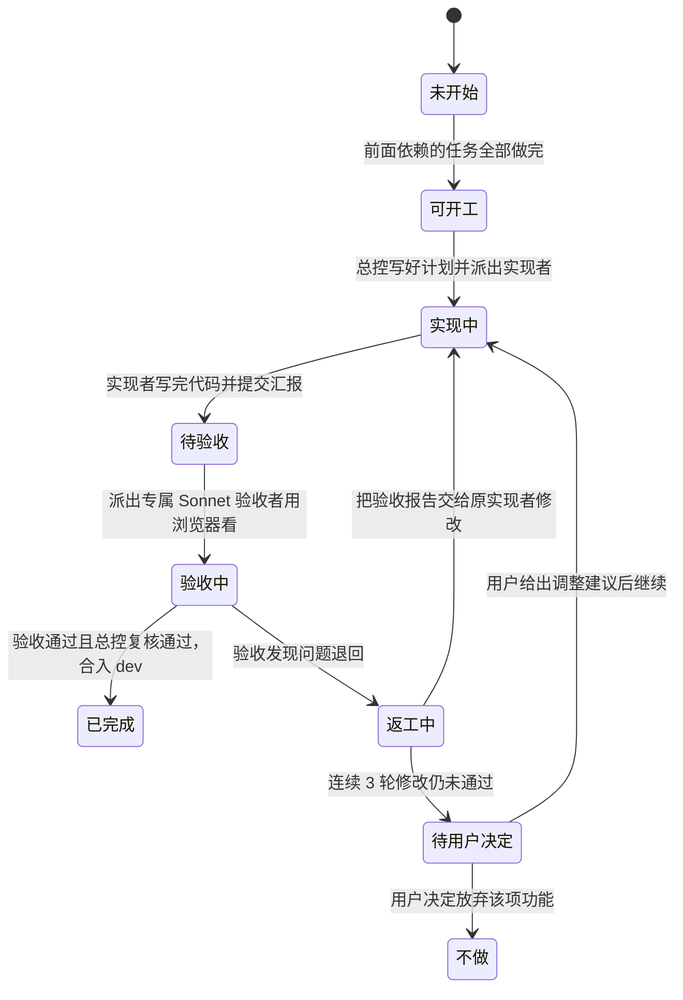

# 蜂群子代理协作工作规程

> 这份文档规定主会话（总指挥）如何派出多个 AI 子代理协同写代码、验收和推进任务。
> 具体的任务清单和先后依赖关系，请看 `ROADMAP.md`。

## 节点生命周期状态图

每个任务节点都会经历下面这段流转过程。像工厂流水线一样，做完一步才能进下一步：



---

## 名词小词典

| 词汇 | 大白话解释 |
| --- | --- |
| 总控 (主会话) | 相当于大工头。负责分配任务、看进度表、检查最终质量，但不亲自写代码。 |
| 子代理 (sub-agent) | 相当于具体干活的工人。被总控派出去独立完成某一项专门的事情。 |
| 实现者 | 专门负责按照图纸动手写代码、修功能的子代理。 |
| 验收者 | 专门负责给写好的代码找茬、挑毛病的质检员子代理。模型固定使用 Sonnet。 |
| worktree (独立工作区) | 在电脑里单独开辟的一块工作文件夹。每个工人有一间独立房间，互不打扰。 |
| 互斥锁 (lock) | 类似于卫生间门锁。一次只能进一个人，先到先用，用完开门，后来的排队。 |
| rebase | 代码重新排队。把自己的新改动挪到别人最新合入的代码后面，避免打架。 |
| 无头浏览器 | 没有显示器界面的纯后台浏览器。AI 用它在后台打开网页并给网页截图。 |

---

## 三个角色的分工职责

每一个任务节点都必须配置两个**完全不同**的子代理：一个负责实现，另一个负责验收。

| 角色 | 由谁担任 | 负责做什么 | 绝对不能做什么 |
| --- | --- | --- | --- |
| **总控** | 主会话（你正在对话的我） | ① 编写执行计划与验收计划<br/>② 创建独立工作区<br/>③ 派发子代理<br/>④ 更新地图进度<br/>⑤ 合入最终代码 | 绝对不亲自直接编写节点的业务代码。 |
| **实现者** | 独立的子代理<br/>（使用默认模型） | ① 按照 `plan.md` 的计划动手修改代码<br/>② 跑通本地自动化测试<br/>③ 提交代码到节点专属分支并写汇报 | 绝对不擅自修改 `ROADMAP.md` 的任务状态，绝对不自己宣布做完了。 |
| **验收者** | 独立的质检子代理<br/>（固定使用模型：<br/>`sub2tok/claude-sonnet-5-5`） | ① 严格按照 `verify.md` 逐条核对<br/>② 必须在后台打开真实浏览器亲眼查看界面<br/>③ 给出客观明确的验收通过或不通过结论 | 绝对不修改任何源码，绝对不替实现者动手修 Bug。保持工作区完全干净。 |

---

## 节点规范文件与目录结构

每个任务节点都在仓库中拥有自己的专属文件夹：

```
.agents-work/upstream-sync/nodes/<节点ID>/
├── plan.md          执行计划书：总控派活前写好
├── verify.md        验收计划书：总控派活前写好，本轮开发期间不许修改
├── impl-<N>.md      第 N 轮实现者汇报：做了什么、自测结果、遗留问题
└── verify-<N>.md    第 N 轮验收者报告：逐条检查结论、证据、截图路径
```

> **注意**：截图等证明材料统一放在 `.agents-work/upstream-sync/nodes/<节点ID>/evidence/<N>/`。这个目录体积较大，配置了忽略规则，不需要提交到 Git。

### 两份核心计划书的编写要求

| 文件名 | 必须包含的关键内容 | 编写原则 |
| --- | --- | --- |
| `plan.md`<br/>（执行计划） | ① **最终目标**：用一两句大白话讲清做完后界面有什么改变。<br/>② **任务范围**：写清哪些文件要改，哪些文件坚决不碰。<br/>③ **上游依据**：列出对应的上游差异台账条目与上游源代码路径。<br/>④ **开发步骤**：按顺序写清楚先改哪里、后改哪里、改成什么样。<br/>⑤ **自测要求**：写清楚开发完后需要跑哪些测试命令、看哪些页面。<br/>⑥ **回报格式**：明确规定 `impl-<N>.md` 里必须填写的总结结构。 | 由总控依据全局地图和上游代码编写，让实现者拿到就能直接照着做。 |
| `verify.md`<br/>（验收计划） | ① **逐条检查项**：每条必须能明确判定「合格」或「不合格」，不留模糊空间。<br/>② **检查操作法**：跑什么命令、开哪个网页链接、点哪个按钮、看什么效果。<br/>③ **浏览器核验**：涉及界面的节点，必须在 桌面/390px手机窄屏 × 浅色/深色 共 4 种组合下对比上游同款示例。<br/>④ **反向挑刺**：故意检查边界情况（如键盘操作、无障碍读屏、服务端渲染、超长文字、空数据）。<br/>⑤ **一票否决**：只要有任何一条不合格，总体结论直接判为「不通过」。 | 验收计划完全独立编写，从产品终态出发，绝不照抄实现者的开发总结。 |

---

## 硬件资源保护与并发上限

当前开发设备为：**Apple M2 Pro 芯片，10 核 CPU，16GB 内存**。为了防止电脑卡死，严格执行资源限制：

| 资源类别 | 最大允许数量 | 设限原因 |
| --- | --- | --- |
| **同时活跃子代理总数** | **3 个** | 每个子代理在工作时都会运行测试、打包代码和启动网页服务。 |
| **同时打开的浏览器会话** | **2 个** | 一个无头后台浏览器在多尺寸截图时大约消耗 0.5 到 1GB 内存。 |
| **同时运行的文档站服务** | **2 个** | VitePress 文档站开发服务每个大约消耗 0.5 到 1GB 内存。 |
| **同时存在的工作区** | **4 个** | 控制磁盘占用，避免多人同时修改全局生成文件造成代码冲突积压。 |
| **单个工作区测试并发数** | **2 个进程** | 跑单测时统一加上参数限制：`pnpm vitest run --maxWorkers=2`。 |

### 内存防爆与排队机制

1. **内存压力检测**：总控每次派出新的子代理前，先在终端检查系统内存。如果可用内存低于 **25%**，暂停派发新任务，等待正在跑的子代理结束后再继续。
2. **浏览器互斥锁**：排队专用锁目录为 `.agents-work/upstream-sync/locks/browser-1` 和 `browser-2`。
   - 任何子代理想要打开浏览器，必须先用 `mkdir` 命令创建其中一个文件夹来拿到锁。
   - 关掉浏览器后，必须立刻用 `rmdir` 删掉文件夹把锁交还。
   - 拿不到锁就必须等待，严禁私自多开浏览器。A2 节点做好的视觉对照工具会自动带上这把锁。在 A2 完成前，由总控人工排期保证不超量。

---

## 独立工作区与端口分配表

为了让每个子代理的代码互不干扰，每个任务节点使用 Git 独立工作区（worktree）。

| 项目 | 约定与规范 |
| --- | --- |
| **创建工作区命令** | `git worktree add ../astryx-vue-wt/<节点ID> -b sync/<节点ID小写>-<简短名> dev` |
| **共用工作区原则** | 同一个任务节点的实现者和验收者使用**同一个工作区**。 |
| **验收者只读铁律** | 验收者只看不改。验收工作结束时，终端运行 `git status` 必须没有任何改动文件，否则本次验收成绩直接作废。 |
| **槽位与端口分配** | 每个活跃的工作区分配一个专属槽位编号（**1 到 4 号**）。<br/>该工作区启动文档站时的专属端口为：**`5170 + 槽位号`**（例如 1 号槽位为 5171，2 号为 5172）。用完后必须及时关闭该服务。 |
| **完工清理** | 任务节点通过验收并合入 `dev` 分支后，总控负责彻底删除该工作区文件夹及对应锁。 |

---

## 派活顺序与合并规则

总控在派发任务时，遵循以下三个规则：

1. **谁卡住的人多就先派谁**：在当前所有「可开工」的节点里，看谁下游依赖的节点最多，优先派谁开工。
2. **验收比新活更着急**：只要有节点处于「待验收」状态，优先派出 Sonnet 验收者去检查，然后再去开新的开发任务。
3. **公共生成文件排队合入**：运行 `pnpm sync` 产生的公共导出文件，同一时间只允许一个节点往主分支合并。后合并的节点必须先 `git rebase` 同步最新主分支代码，再在本地重新跑一次 `pnpm sync`，绝不手动解决生成文件冲突。

---

## 总控验收后的终审复核

当 Sonnet 验收者给出「通过」结论后，总控在把节点标记为「已完成」前，必须亲手完成以下 3 件事：

1. **查验真凭实据**：完整通读 `verify-<N>.md`，确认每一条检查项都附带了明确的命令输出、截图或证据，没有任何一项目测敷衍或留空。
2. **亲自跑一遍命令**：总控亲自进入该节点的工作区，运行一次 `pnpm check`，确保类型检查、代码规范、测试全绿。
3. **安全合入并更新看板**：把节点分支合入 `dev` 分支，删掉临时工作区，在 `ROADMAP.md` 中把该节点状态改成「✅ 已完成」，并同步更新树状图中的颜色与状态。
