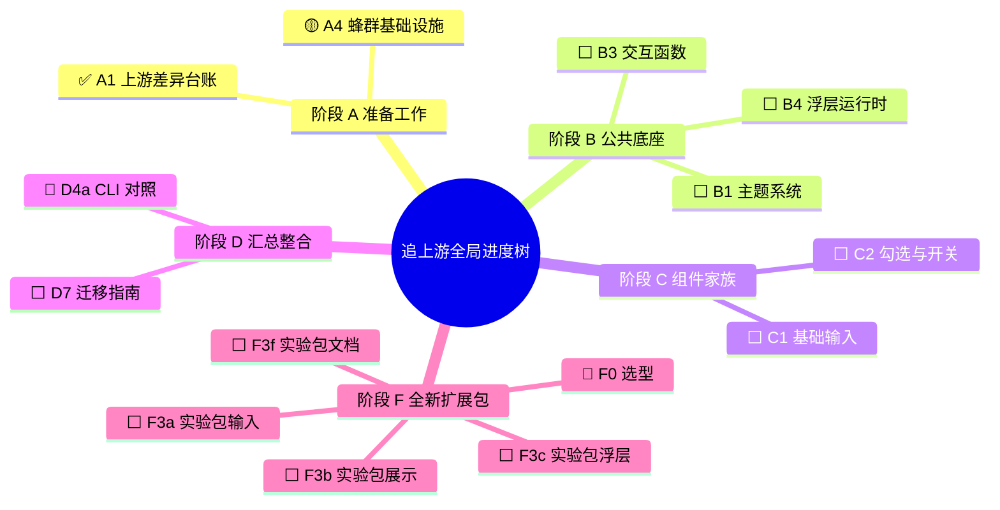
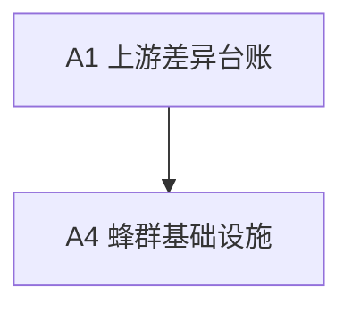

# 追上游任务地图（测试用裁剪样本）

> 这份样本只保留 status.mjs 关心的两块，其它内容用来确认改写时不被碰到。

## 全局进度树状图

### 状态图例

- ⬜ 未开始
- ✅ 已完成

## 当前状态总表

| 节点 | 名称 | 依赖 | 状态 | 轮次 | 实现者 | 验收者 | 最近验收结论 | PR |
| --- | --- | --- | --- | --- | --- | --- | --- | --- |
| A1 | 上游差异台账 | — | ✅ 已完成 | 1 | A1-impl | A1-verify | 通过 21/21 | 11ddc15 |
| A4 | 蜂群基础设施 | A1 | 🟡 实现中 | 1 | A4-impl | | | |
| B1 | 主题系统 | A4 | ⬜ 未开始 | 0 | | | | |
| B3 | 交互函数 | A4 | ⬜ 未开始 | 0 | | | | |
| B4 | 浮层运行时 | B3 | ⬜ 未开始 | 0 | | | | |
| C1 | 基础输入 | B1 B3 | ⬜ 未开始 | 0 | | | | |
| C2 | 勾选与开关 | B3 | ⬜ 未开始 | 0 | | | | |
| D4a | CLI 对照 | A1 | 🔵 可开工 | 0 | | | | |
| D7 | 迁移指南 | C全部 | ⬜ 未开始 | 0 | | | | |
| F0 | 选型 | A1 | 🔵 可开工 | 0 | | | | |
| F3a | 实验包输入 | F0 C1 | ⬜ 未开始 | 0 | | | | |
| F3b | 实验包展示 | F0 | ⬜ 未开始 | 0 | | | | |
| F3c | 实验包浮层 | F0 B4 | ⬜ 未开始 | 0 | | | | |
| F3f | 实验包文档 | F3a–F3c | ⬜ 未开始 | 0 | | | | |

---

## 各阶段任务细节说明

| 节点 | 要做什么 | 依赖谁 |
| --- | --- | --- |
| A4 蜂群基础设施 | 🟡 这一行不是总表，emoji 不能被改 | A1 |
